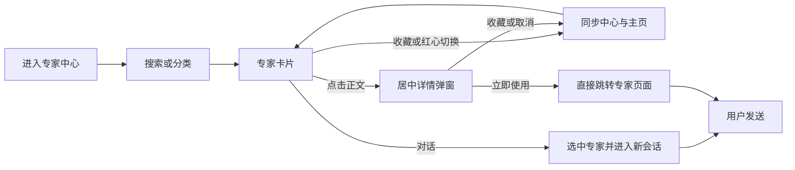
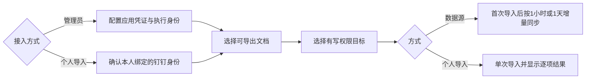
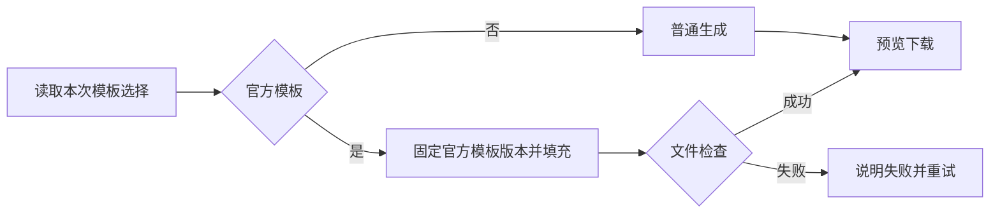
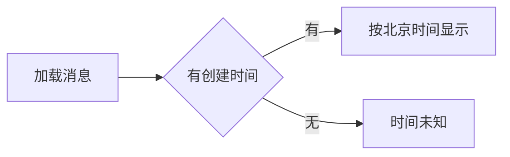
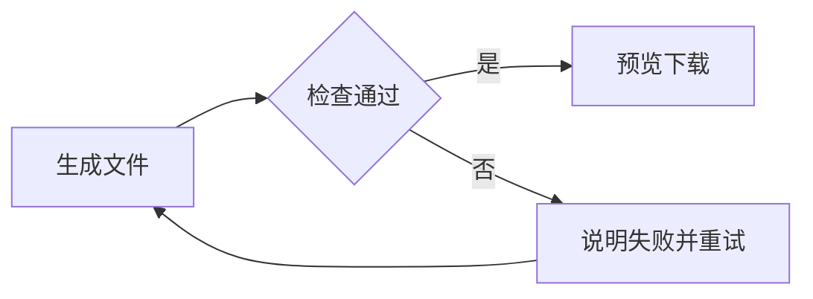
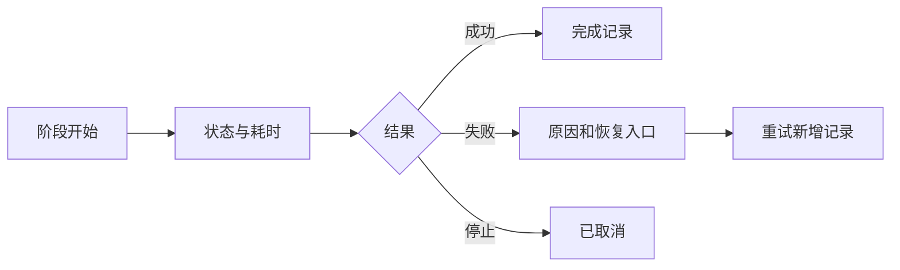
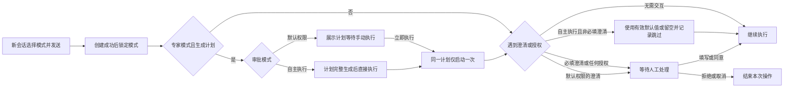
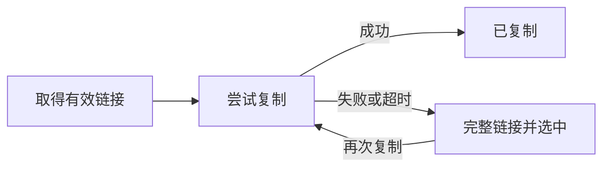

***产品需求说明书***


**天马智擎 AI 工作台 V1.3.0**


# 版本信息

| **版本号** | **时间** | **状态** | **简要描述** | **部门** | **责任产品** | **批准人** |
|-------------|----------|----------|----------------|----------|----------------|-------------|
| V1.3.0 | 2026-10-10 | 待评审 | 专家中心、快捷呼出专家、钉钉文档接入、网页引用溯源、PPT模板套用及体验优化 |  |  |  |

# 关于本文档

本文说明本期功能范围、交互流程、数据字段和业务规则，供产品评审、开发和测试使用。

## 沟通要求

| **序号** | **部门/角色** | **沟通内容** | **沟通结果** |
|----------|-----------------|----------------|----------------|
|  |  |  |  |

# 产品概述

支持发现和收藏专家、在输入框快速选用，并把有权限的钉钉文档转存到知识中心；同步完善引用、文件交付及会话体验。

# 功能需求

## 功能模块

| **编号** | **功能名称** | **功能描述** | **优先级** |
|----------|----------------|----------------|-------------|
| M1 | 专家中心 | 发现、说明、收藏与主页联动 | 评审1 |
| M2 | 快捷呼出专家 | @选择，最近使用排序与滚动加载 | 评审2 |
| M3 | 钉钉文档接入 | 管理员持续接入，用户按本人身份导入 | 评审3 |
| M4 | 网页引用溯源 | 文中编号、下方来源与右侧预览 | 评审4 |
| M5 | PPT模板套用 | 套用天马PPT模板生成文件 | 评审5 |
| M6 | 体验优化 | 消息时间、文件规范、执行过程、自动执行、复制兜底、任务置顶 | 最后评审 |

## 通用规则

| **规则** | **说明** |
|----------|----------|
| 字段与时间 | 长度按UTF-16字符计；一般文本去首尾空白，凭证不自动修改。时间按北京时间显示，以服务端为准 |
| 权限 | 沿用管理员/普通用户角色，接口再次鉴权。收藏不授予专家、知识或工具权限，切换账号清除前一账号状态 |
| 请求 | 保存、同步、导入和执行防重复；结果未知先查询原请求。旧请求不覆盖新选择；冲突/失败保留非敏感草稿 |
| 来源异常 | 读取失败、权限拒绝、单次404、未完成分页不等于空库或删除；失权停止展示受保护内容，恢复后重新校验 |
| 弹层展示 | 数据源和专家详情用居中弹窗，引用用右侧预览 |

### **M1-专家中心**

#### **功能需求描述**

目前主页直接展示有权限的全部已发布专家，常用专家不易快速找到，能力和使用限制也缺少统一说明。新增专家中心，支持查找、查看说明和收藏，主页集中展示已收藏专家。

#### **业务主流程图及说明**



#### **界面原型**

##### **专家中心与主页**

**专家中心**


**专家中心目录中部**


**专家中心目录末页**


**专家中心侧栏收起**


**专家中心未收藏**


**收藏空态**


**搜索无结果**


**专家详情上半部**


**专家详情下半部**


**收藏同步主页**


**发布快照详情**


**主页取消收藏**


**主页空分类回退**


**收藏达到上限**


| **动作** | **显示** | **类型** | **描述** |
|----------|----------|----------|----------|
| 【专家中心】进入 | 标题、搜索、分类、卡片 | 页面 | · 标题为“专家中心”<br>· 搜索位于右上；分类为全部、通用、商品、直播、B2B、B2C、门店<br>· 列出用户有权限查看的智能体 |
| 【会话侧栏】展开/收起 | 工作台会话列表 | 侧栏 | 沿用工作台侧栏，支持展开和收起 |
| 【搜索/分类】修改 | 匹配卡片 | 筛选 | 搜索仅匹配专家名称和简介，不匹配其他字段 |
| 【专家卡片】查看 | 图、名称、简介、接入系统标签 | 竖向卡片 | 头像使用对应专家官方形象；接入系统标签最多显示3个，长标签省略，完整列表在详情中展示 |
| 【专家卡片正文】点击 | 结构化使用说明 | 居中弹窗 | 展示发布快照详情 |
| 【卡片红心】点击 | 收藏/取消收藏 | 独立按钮 | · 右上独立红心，不显示箭头<br>· 点击不打开详情、不选专家 |
| 【卡片收藏】点击 | 按钮变为“对话” | 底部按钮 | 未收藏时展示“收藏”；收藏成功后同步中心与主页 |
| 【卡片对话】点击 | 已选专家的新会话 | 底部按钮 | 已收藏时展示“对话”；选中专家并带入新会话，不自动发送 |
| 【详情收藏】点击 | 同一收藏状态 | 按钮 | 与卡片和主页同步 |
| 【立即使用/快捷开始】点击 | 直接跳转专家页面 | 按钮 | 立即使用不带入快捷提示词，快捷开始带入对应提示词；均直接替换已有正文，无需用户确认 |
| 【主页业务专家】切分组 | 已收藏专家 | 分类 | · “收藏”固定首组并显示全部收藏；通用、商品、直播、B2B、B2C、门店仅有对应收藏时展示<br>· 所选分类失去最后一位专家后隐藏并返回“收藏”，保留当前专家和草稿 |
| 【主页红心】取消 | 移除该卡片 | 独立按钮 | 与中心同步，不删除历史任务、不改变当前专家和草稿 |
| 【侧栏专家中心】点击 | 专家中心 | 导航 | 主页不另放跳转链接；收藏为空保留空态，可“添加专家” |

##### **智能体设置**

**智能体目录列表**


**智能体目录末页**


**使用说明编辑回显**


**说明发布校验**


**创建使用说明**


**基础设定发布校验**


| **动作** | **显示** | **类型** | **描述** |
|----------|----------|----------|----------|
| 【智能体管理】进入 | 耶虎及18位业务专家 | 列表 | 耶虎归日常办公；业务专家信息与中心一致；列表可滚动查看 |
| 【使用说明】编辑 | 接入系统、输入要求、输出形式、使用限制 | 普通表单 | 直接展示普通标签和表单，不分组、不加包装卡片或编号装饰 |
| 【保存草稿】点击 | 保存结果 | 按钮 | 允许必填项暂缺，不改变发布内容 |
| 【发布】点击 | 首个未通过校验的字段或发布结果 | 按钮 | · 未填只用红框突出，不显示错误文字<br>· 聚焦首个错误字段并保留输入；通过后更新已发布版本 |
| 【重新编辑】进入 | 原草稿 | 回显 | 保留多行、标签、能力扩展和版本；只改说明不回退版本 |

#### **数据说明**

卡片与详情读取同一专家的已发布版本，保存草稿不改变展示内容。前两表的“必需”指是否展示，设置表单的“必需”指是否需要填写；只读展示项不要求用户输入。

##### **1\. 展示卡片**

| **字段名** | **数据类型** | **长度** | **默认值** | **必需** | **约束说明** |
|-------------|----------------|----------|-------------|----------|----------------|
| 头像 | 图片地址 | 1张 | 名称首字 | 是 | 来源：设置→基础设定→智能体图标的已发布值；对应专家使用官方头像，未提供图片时显示名称首字 |
| 专家名称 | 单行文本 | 1–50字符 | 无 | 是 | 来源：设置→基础设定→名称的已发布值；单行省略，悬浮可看全文 |
| 简介 | 文本 | 0–200字符 | 默认智能体 | 是 | 来源：设置→基础设定→简介的已发布值；为空时显示“默认智能体”，最多3行，悬浮可看全文 |
| 接入系统标签 | 标签数组 | 完整列表≤8项；卡片≤3项 | 无 | 有值时 | 来源：设置→使用说明→接入系统的已发布完整列表，包含自动项和手动补充项；卡片按保存顺序展示前3项，长标签省略并可悬浮查看全文；点击+N弹出浮层仅展示未展示的其余标签，不重复已可见标签；详情弹窗中直接全部展示，不使用+N折叠。不只取基础设定的标签 |
| 收藏状态 | 布尔值 | 1值；新增收藏上限18位 | 按初始化规则 | 是 | 来源：当前用户的收藏记录，以用户和专家ID对应；已收藏为实心红心，未收藏为空心红心，与主页及详情同步，不取专家的收藏总数 |
| 主按钮 | 派生文案 | 1项 | 收藏 | 是 | 来源：收藏状态；未收藏固定显示“收藏”，已收藏固定显示“对话”。不可用时按钮禁用；悬浮提示分别为“维护中，暂不可用”“已下线，暂不可用”，禁止发起对话 |
| 搜索词 | 单行文本 | 0–60字符 | 空 | 否 | 来源：页面右上搜索框；去首尾空白、忽略大小写，不作为专家配置保存 |
| 分类/主页分组 | 枚举单选 | 1项 | 中心“全部”；主页“收藏” | 是 | 来源：设置→基础设定→分类的已发布值；业务分类固定为通用、商品、直播、B2B、B2C、门店。中心增加“全部”，主页增加“收藏”；分类文字不重复放入卡片，主页空分类隐藏 |

##### **2\. 专家详情**

固定区块为“基本信息、能力范围、知识边界、能力边界与使用约束”；顶部固定显示“使用说明”和“了解适用范围与使用边界”。简介上方显示“简介”标签。以下字段均为只读，不能在详情中编辑。

| **字段名** | **数据类型** | **长度** | **默认值** | **必需** | **约束说明** |
|-------------|----------------|----------|-------------|----------|----------------|
| 头像 | 图片地址 | 1张 | 名称首字 | 是 | 来源及缺失处理同展示卡片的“头像” |
| 专家名称 | 单行文本 | 1–50字符 | 无 | 是 | 来源：设置→基础设定→名称的已发布值，与所点击卡片一致 |
| 简介 | 文本 | 0–200字符 | 默认智能体 | 是 | 来源：设置→基础设定→简介的已发布值；详情展示完整内容，上方显示“简介”标签 |
| 分类 | 枚举 | 1项 | 无 | 是 | 来源：设置→基础设定→分类的已发布值；按展示卡片的六类名称显示 |
| 部门 | 只读文本 | 原值 | 无 | 有值时 | 来源：智能体已有负责人信息中的所属部门，不取基础设定的“适用部门”；无值时隐藏，并移除分类后的分隔符 |
| 版本 | 版本文本 | 原值 | 未提供 | 是 | 来源：设置→基础设定→版本的已发布值；固定前缀“版本”，不以草稿版本替换 |
| 运行状态 | 枚举 | 1项 | 无 | 是 | 来源：智能体管理的当前启停/维护状态；固定文案“在线”“维护中”“已下线”，不以收藏状态推断 |
| 负责人 | 只读文本 | 原值 | 未提供 | 是 | 基本信息；来源：智能体已有负责人记录，自动显示“姓名（所属部门）”，无部门只显示姓名，无姓名显示“未提供”。不在使用说明中填写，不默认认定为当前查看人 |
| 上线时间 | 时间戳 | 显示YYYY-MM-DD | 未提供 | 是 | 基本信息；来源：该专家首次成功发布记录，后续重新发布不重置；缺失或无效不取创建时间替代 |
| 更新时间 | 时间戳 | 显示YYYY-MM-DD | 未提供 | 是 | 基本信息；来源：最近一次成功发布记录。保存草稿、收藏或修改任务均不改变该时间 |
| 支持文件格式 | 格式数组 | 按实际配置 | 未提供 | 是 | 基本信息；来源：该专家已有能力配置提供的支持格式，按平台现有能力清单过滤并去重；去扩展名前导点、统一大写。未提供配置显示“未提供”，明确空列表显示“未配置”；不等同于头像上传格式 |
| 接入系统 | 标签数组 | 1–8项；单项2–20字符 | 暂未配置 | 是 | 能力范围；来源：设置→使用说明→接入系统的已发布完整列表，显示全部项；历史无值显示“暂未配置” |
| 输入要求 | 多行文本 | 0–120字符 | 无 | 有值时 | 能力范围；来源：设置→使用说明→输入要求的已发布值，保留换行；为空隐藏本行 |
| 输出形式 | 多行文本 | 0–120字符 | 无 | 有值时 | 能力范围；来源：设置→使用说明→输出形式的已发布值，保留换行；为空隐藏本行 |
| 使用限制 | 多行文本 | 1–300字符；历史原文保留 | 暂未配置 | 是 | 能力边界与使用约束；来源：设置→使用说明→使用限制的已发布值。历史未结构化说明保留原文，首次编辑再按表单校验，不在展示时截断 |
| 知识内容 | 知识库名称列表 | 按实际绑定数量 | 未引用知识库 | 是 | 知识边界；来源：设置→能力扩展→知识库的已发布关联，库名取知识中心元信息；若配置粒度为文档，需取得其所属库关联，不能用文档名代替库名。已选文档但未提供所属库信息时显示"未提供"；已知库ID但无名称时显示"未提供名称"。联网查询状态已在接入系统标签中体现，不再重复展示 |
| 知识更新时间 | 知识库×时间戳 | 每库显示YYYY-MM-DD | 未提供 | 是 | 知识边界；来源：每个关联知识库最近一次成功更新记录，逐库显示“库名：日期”；知识库成功更新后刷新，失败不改成功时间，不取专家发布时间或文档选择时间。无库显示“未引用知识库”，有文档但库关联未知显示“未提供” |
| 使用约束 | 固定文本 | 固定全文 | 固定文案 | 是 | 来源：平台固定文案，不在设置表单中编辑。全文：“AI 生成内容仅供辅助参考，可能存在理解偏差、信息遗漏或生成错误。涉及关键数据、业务结论及发送、删除、发布、审批、下单、对外分享等操作时，必须核对原始来源并由责任人确认。” |
| 快捷问法 | 文本数组 | 单项≤500字符；保留历史原值 | 无 | 有值时 | 来源：设置→快捷提示词→提示词内容的已发布列表，沿用配置顺序；点击带入对应内容，配置标题只用于管理。无项时不展示空按钮 |
| 收藏按钮 | 派生文案 | 1项 | 收藏 | 是 | 来源：当前用户收藏状态；固定文案“收藏”“已收藏”，同卡片状态 |
| 使用按钮 | 派生文案 | 1项 | 立即使用 | 是 | 来源：专家当前可用状态；可用时固定文案“立即使用”，否则“暂不可用”并禁用 |

##### **3\. 设置表单**

仅列与本需求展示相关的设置项，其他创建配置沿用现有规则。使用说明只编辑接入系统、输入要求、输出形式、使用限制；负责人、上线/更新时间、支持文件格式、知识边界和固定使用约束不新增输入项。

| **字段名** | **数据类型** | **长度** | **默认值** | **必需** | **约束说明** |
|-------------|----------------|----------|-------------|----------|----------------|
| 智能体图标 | 图片文件 | ≤2MB；1:1；≥128×128px | 已有图标/平台默认图标 | 是（可用默认图标） | 位置：基础设定→智能体图标；沿用现有JPG/JPEG、PNG、SVG、WebP上传能力，可使用默认图标；成功发布后用于卡片和详情头像 |
| 名称 | 单行文本 | 1–50字符 | 新建空；编辑原值 | 保存/发布时是 | 位置：基础设定→名称；去首尾空白后不能为空；成功发布后用于卡片和详情名称 |
| 简介 | 多行文本 | 发布1–200字符 | 新建空；编辑原值 | 发布时是 | 位置：基础设定→简介；草稿可空，发布时去首尾空白后不能为空，不把占位文字算作填写。历史已发布空值展示“默认智能体”；成功发布后用于卡片和详情简介 |
| 分类 | 枚举单选 | 1项 | 通用 | 是 | 位置：基础设定→分类；六类枚举见展示卡片，不把“全部”“收藏”作为专家分类；耶虎仍属日常办公，不进入中心 |
| 版本 | 新建正整数/编辑版本文本 | 新建≥1；编辑沿用原值，不新增长度上限 | 新建1；编辑原值 | 否 | 位置：基础设定→版本；沿用现有版本字段，编辑说明不自动退回或递增，成功发布后用于详情版本 |
| 基础接入系统 | 枚举多选 | 新选择≤3项 | 新建“知识库”；编辑原值 | 否 | 位置：基础设定→接入系统标签；现有选项DWS、知识库、联网、文档、数据平台；自动带入使用说明，已有超量配置保留，不直接决定卡片展示的完整标签列表 |
| 接入系统 | 标签数组 | 发布1–8项；单项2–20字符 | 基础设定/能力扩展自动项＋已有手动项 | 保存/发布时是 | 位置：使用说明→接入系统；基础标签和已接入能力自动带入，选中知识文档带入“知识库”、启用联网能力带入“联网”，自动项只读。支持回车或中英文逗号录入手动项，去首尾空白后去重；自动与手动合计≤8项。占位文案“补充业务系统名称；共最多 8 个”；成功发布后为卡片和详情的标签来源，手填标签不授予对应能力 |
| 输入要求 | 多行文本 | 0–120字符 | 空 | 否 | 位置：使用说明→输入要求；保留换行。占位文案“例如：需提供商品链接、日期范围和已授权文件”；占位文案不保存为内容 |
| 输出形式 | 多行文本 | 0–120字符 | 空 | 否 | 位置：使用说明→输出形式；保留换行。占位文案“例如：表格、报告、清单或文件”；占位文案不保存为内容 |
| 使用限制 | 多行文本 | 发布1–300字符 | 空 | 发布时是 | 位置：使用说明→使用限制；去首尾空白后不能为空，草稿可空。占位文案“请说明不支持的任务、查询维度、数据范围及使用限制。例如：不支持按链接维度查询数据；不支持未授权部门数据；不适用于实时库存决策。”；占位文案不算已填 |
| 说明合计 | 系统计算字符数 | ≤1000字符 | 按表单计算 | 发布时是 | 合计包含接入系统、输入要求、输出形式、使用限制及保存时的固定字段标题、换行；不是新增文本输入框。超限禁发布，不截断历史原文 |
| 绑定知识内容 | 现有知识库/文档多选 | 沿用现有选择规则，不新增数量限制 | 编辑原配置；新建空 | 否 | 位置：能力扩展→知识库；沿用现有选择方式，开发需取得已选文档所属库关联及知识中心元信息。仅有文档名称而未取得关联时，按详情表展示未知，不以名称猜库或补造更新时间 |
| 联网能力 | 已启用能力状态 | 1值 | 按现有能力配置 | 否 | 位置：能力扩展→工具箱中的联网工具；不在使用说明新增联网开关，详情读取该能力配置结果。手填接入系统名称不代表已经启用工具 |
| 提示词标题 | 单行文本 | 1–20字符 | 新建空；编辑原值 | 新增提示词时是 | 位置：快捷提示词→提示词卡片；用于设置中的识别与管理 |
| 提示词内容 | 多行文本 | 1–500字符 | 新建空；编辑原值 | 新增提示词时是 | 位置：快捷提示词→提示词内容；保存后进入快捷问法列表，成功发布后点击带入输入框 |

#### **业务规则和约束条件**

| **规则** | **说明** |
|----------|----------|
| 展示范围 | 专家中心展示当前用户有权限的已发布业务专家，主页仅展示收藏；不提供热门、评分和使用次数。初始目录为业务专家清单中的18位已上线专家；耶虎属于日常办公，不进入专家中心、收藏或@列表，开发中和测试中的专家不纳入 |
| 初始化与上限 | 上线一次将当前已发布且有权限的专家全部收藏，未来新发布不自动加入。已有收藏保留；存量超过18也保留，但降至18以下才能新增 |
| 收藏顺序/失败 | 主页最近收藏在前，中心默认顺序；失败回滚，重复点击不新增，取消不结束会话 |
| 专家失效 | 维护/下线保留收藏位但不可新使用；撤回/删除/失权移除。发送前再校验，失效保留草稿、不静默换专家 |
| 弹窗内容 | 展示字段、来源、固定文案及空值处理以本模块“数据说明→专家详情”为准；输入要求和输出形式为空时不展示 |
| 自动带入与历史 | 自动带入的接入系统标签在基础设定或能力扩展中修改。详情读取已发布版本，旧任务保留原版本；历史纯文本可查看，首次编辑保留原文，超限要求修订 |

#### **补充说明**
- 前端：中心、主页共用收藏状态；设置编辑草稿，详情读取快照。
- 后端：返回当前用户可见专家，按账号保存收藏和迁移标记；校验18位上限，超限存量不截断。详情取已有负责人、发布记录和支持格式；知识信息需取得绑定库/文档所属库、库名称及最近成功更新时间，未返回时使用表中缺失文案，不按文件名拼接库信息。

### **M2-快捷呼出专家**

#### **功能需求描述**

编写问题时，查找和选择专家需要与输入操作分开进行，容易打断编辑。支持在输入框通过@快捷选择专家，并保留已输入的正文与附件。

#### **业务主流程图及说明**

```mermaid
flowchart LR
 A[输入@] --> B[查询专家]
 B -->|滚到底| C[加载下一批5条]
 C --> B
 B -->|选择| D[替换最前的专家标签]
 D --> E[正文紧随标签]
 E --> F[发送前校验]
```

#### **界面原型**

**快捷专家候选与键盘**


**选择后切换专家模式**


**快捷专家无结果**


**专家滚动加载**


**再次选择专家**


| **动作** | **显示** | **类型** | **描述** |
|----------|----------|----------|----------|
| 【输入框】输入@ | “专家”小标题、头像名称列表 | 浮层 | · 不区分邮箱/标点/文首<br>· 无顶部搜索条或搜索框、底部键盘说明，不显示简介或更多专家 |
| 【输入框】在@后输入检索词 | 匹配专家 | 检索 | 在输入框内检索名称或能力，变化后从首批查询 |
| 【列表】滚到底 | 后续5条/加载中/失败 | 懒加载 | 无翻页按钮；到底不重复请求，失败可重试 |
| 【候选】点击/Enter | 单个专家标签 | 选择 | 标签固定输入最前，提示词紧随同一行，不另起一行 |
| 【再次@】选另一位 | 替换当前专家 | 单选 | 最后选择生效，保留正文、附件和光标，不叠加标签 |
| 【标签移除】点击 | 原助手/专家 | 图标 | 主页恢复日常模式，会话恢复原专家，不清正文 |
| 【列表】键盘操作 | 高亮/关闭 | ↑↓/Enter/Esc/Tab | ↑↓移动，Enter只选择，Esc关闭，Tab关闭并正常移动焦点 |

#### **数据说明**

| **字段名** | **数据类型** | **长度** | **默认值** | **必需** | **约束说明** |
|-------------|----------------|----------|-------------|----------|----------------|
| 检索词 | 搜索文本 | 0–60字符 | 空 | 否 | 变化后从首批查询 |
| 候选类型 | 枚举 | 1项 | 专家 | 是 | 本期专家；后续货号/人员独立检索和加载 |
| 加载批量 | 正整数 | 固定5 | 5 | 是 | 返回后续游标与是否还有结果 |
| 最近使用时间 | 用户×类型×对象 | 时间戳 | 无 | 否 | 成功选择时更新；相同/无记录用默认顺序 |
| 所选专家 | ID及发布版本 | 0或1位 | 未选 | 否 | 随消息提交专家ID和发布版本，按ID确定对应专家 |

#### **业务规则和约束条件**

| **规则** | **说明** |
|----------|----------|
| 触发与范围 | 本期仅桌面端；输入@或全角＠即触发，展示当前有权使用的全部可用专家，不限收藏 |
| 选择与正文 | 主页日常模式选择后切到业务专家模式；会话仅影响此后发送。仅移除本次@检索词，保留前后文字；选择不发送、不收藏 |
| 加载与顺序 | 候选按最近选择时间倒序排列；本次打开期间顺序固定，下次打开按最新选择时间重新排序。重复触底不重复加载，旧请求不覆盖新检索 |
| 输入与运行 | 中文组合输入不确认/误发送；无结果/加载失败Enter不发送。运行中可编辑下一条，不能通过@重启当前任务 |

#### **补充说明**
- 前端：标签为输入前缀，正文正常编辑；浮层优先上方，空间不足时下浮。
- 后端：按当前用户过滤专家、记录最近选择，每次返回5条及游标；各类型独立保存状态。

### **M3-钉钉文档接入**

#### **功能需求描述**

钉钉资料与工作台知识库分开维护，人工转存和更新操作重复，接入身份与文档访问权限也需要区分。提供管理员持续同步和用户按本人身份单次导入两种方式，便于资料在知识中心使用。

#### **业务主流程图及说明**



#### **界面原型**

##### **管理员数据源**

**接入首页**


**无连接**


**凭证失效**


**权限异常**


**待校验**


**配置连接**


**必填校验**


**选择范围**


**无可访问库**


**目标与同步规则**


**新建目标库**


**连接管理弹窗**


**修改连接名称**


**编辑同步范围**


**更换写入位置**


**修改同步时间**


**断开确认**


**已断开**


**重新授权**


**同步进行中**


**同步失败项**


**失败项重试完成**


**来源目录读取失败**


**来源目录加载中**


**每小时增量同步**


**不可导出的文档**


| **动作** | **显示** | **类型** | **描述** |
|----------|----------|----------|----------|
| 【知识接入】进入 | 连接、凭证、来源权限状态 | 管理员页面 | 普通用户不展示；配置/管理/同步/断开仅管理员 |
| 【新建数据源】点击 | 凭证与执行身份 | 弹窗 | 分别说明应用权限与钉钉访问身份 |
| 【测试连接】点击 | 结果 | 按钮 | 修改凭证清空旧校验和来源选择；Secret不回显 |
| 【同步范围】选择 | 一个库的目录/文档 | 树选择 | 无权不展示，不可导出/平台不支持置灰 |
| 【更新周期】选择 | 每小时/每天 | 单选 | 每天选择时间；每小时显示下一次时间 |
| 【连接管理】点击 | 范围、目标、周期、结果 | 居中弹窗 | 凭证失效/权限异常分开展示，提供重新授权 |
| 【失败项重试】点击 | 新运行结果 | 按钮 | 不重做成功项；移出范围的失败项仅留记录 |
| 【断开】确认 | 已断开 | 确认弹窗 | 停排程并取消未完成任务，保留已有内容 |

##### **用户导入**

**我的钉钉身份**


**个人选择文档**


**个人导入目标**


**个人导入结果**


**个人身份失效**


**个人无写入库**


**个人未绑定身份**


**个人导入重试完成**


| **动作** | **显示** | **类型** | **描述** |
|----------|----------|----------|----------|
| 【导入钉钉文档】点击 | 我的钉钉身份 | 弹窗 | 两种角色均可；未绑定/失效先本人授权 |
| 【我的身份】查看 | 当前账号对应姓名/企业 | 只读 | 不允许填写/替换UserID，不展示应用Secret |
| 【文档】选择 | 本人有权且可导出文档 | 多选 | 不用管理员或他人身份扩大范围 |
| 【目标库】选择 | 有写权限目标 | 单选 | 选已有或新建，无权目标不可选 |
| 【导入】提交 | 逐项结果 | 单次任务 | 成功/跳过/失败，可重试失败项，不建立个人定时连接 |

#### **数据说明**

| **字段名** | **数据类型** | **长度** | **默认值** | **必需** | **约束说明** |
|-------------|----------------|----------|-------------|----------|----------------|
| 连接名称 | 单行文本 | 1–50字符 | 空 | 管理员是 | 企业内同名不可保存 |
| AppKey | 单行文本 | 1–256字符 | 空 | 管理员是 | 不含空白 |
| App Secret | 密码 | 1–512字符 | 空 | 管理员是 | 不含空白，不回显/入日志 |
| 数据源UserID | 单行文本 | 1–128字符 | 空 | 管理员授权方式需要时 | 明示连接执行身份；普通用户不可借此指定自己的身份 |
| 我的钉钉身份 | 绑定账号 | 1位 | 当前账号对应身份 | 个人是 | 后端从可信绑定获取，前端只读 |
| 来源库 | 单选ID | 1个 | 未选 | 管理员是 | 仅执行身份/本人可访问的库 |
| 范围 | 目录/文档集合 | 至少1篇有效文档 | 空 | 是 | 数据源可选目录动态跟进；个人导入仅本次文档 |
| 文档搜索 | 搜索文本 | 0–60字符 | 空 | 否 | 不改变勾选 |
| 目标方式 | 枚举 | 1项 | 已有 | 是 | 已有/新建 |
| 已有目标 | 单选ID | 1个 | 未选 | 已有时 | 本人有写权限 |
| 新库名称 | 单行文本 | 1–60字符 | 空 | 新建时 | 个人新建在个人空间；重名提示修改，不合并 |
| 来源文件夹 | 单行文本 | 1–80字符 | 钉钉制度文档 | 管理员是 | 同连接复用，与其他来源同名加数字 |
| 更新周期 | 枚举 | 1项 | 每天 | 管理员是 | 每小时/每天，均增量 |
| 每日时间 | 时间 | HH:mm | 00:00 | 每天时 | 北京时间，今天已过则次日 |
| 状态筛选 | 枚举 | 1项 | 全部 | 是 | 已连接/同步中/授权异常/待校验/已断开 |

#### **业务规则和约束条件**

| **规则** | **说明** |
|----------|----------|
| 权限A/B | A是用户对文档的访问权限；B是应用开放的接口/导出能力及访问身份。分别校验：用户能看不代表应用能导，应用能访问不代表当前用户能看 |
| 身份与角色 | 管理员管凭证；普通用户不能填写他人UserID冒充身份。个人导入使用本人绑定身份校验来源权限，再校验平台角色与目标写权限；使用已入库内容仍需来源权限与平台知识权限共同满足 |
| 本期格式 | 只保证钉钉可导出且天马可接收解析的文档转存；原生多维表本期不支持，不以查看权承诺全部类型可导出 |
| 更新调度 | 首次导入当前范围，之后每小时/每天只处理新增或变化，未变跳过。每小时从配置生效起间隔1小时；单连接不并发，运行中到期合并一次待执行 |
| 失败恢复 | 单文档自动重试最多2次，其他继续；重试关联原任务新建记录。凭证/权限错误先恢复授权；目录读取失败可重读，统计未完成不能继续 |
| 更新与重名 | 管理员持续同步按源稳定ID更新，改名/移动不重复；同名加（2）、（3）。新版本解析建索引成功后替换，失败保留旧成功版并标更新失败。个人再次发起新导入生成独立副本，同名加（2）、（3）；同请求重试不复制已成功项 |
| 源文档删除 | 完整读取并确认删除后，管理员连接保留转存记录、标来源已删除且停止检索；个人不定时对账，预览或检索时发现来源已删除或无法确认权限则禁止访问，不在后台删除本地副本 |
| 范围与目标 | 缩小范围后停止更新移出的内容，保留已有内容；更换目标后，向新目标首次导入当前范围，旧目标标记停止更新。普通配置保存不立即启动，创建和重新授权除外 |
| 断开/失权 | 留内容不等于留访问权；权限无法确认不可检索预览。重新授权核验原企业、来源与目标写权 |
| 重复与计数 | 管理员同企业、来源、规范化范围和目标不重复建连接；个人按请求号防重复。已选数仅计完整读取后的可导出且平台支持的文档 |

#### **补充说明**
- 前端：管理员连接和个人导入分开；普通用户只看本人身份，不提供任意UserID输入。
- 后端：服务端保存应用凭证，从当前登录账号取绑定身份，分别校验来源与目标；按1小时/1天执行增量，保存源文档与目标对应关系。
- 接入条件：UserID用于标识用户，不代表已获得授权。接入前验证绑定用户权限、可导出类型和文档变更识别；无法可靠校验权限时不开放接入，不另建文档访问权限体系。
- 待确认项：接入首页3张统计卡的名称、字段、统计口径及更新频率待评审确认。

### **M4-网页引用溯源**

#### **功能需求描述**

当前知识库问答已支持来源溯源，网页内容尚未支持文中引用及统一预览，用户难以直接核对网页依据。补充文中编号、回复下方来源及右侧预览，统一知识库和网页来源的查看方式。

#### **业务主流程图及说明**


#### **界面原型**

原型 36｜文中编号与下方来源


原型 37｜网页来源卡片


原型 38｜知识片段定位高亮


原型 39｜全部来源及类型筛选


原型 40｜知识预览失败


原型 41｜知识来源失权


原型 42｜网页信息缺失


原型 43｜引用元数据缺失


原型 44｜回答无引用


| **动作** | **显示** | **类型** | **描述** |
|----------|----------|----------|----------|
| 【文中编号】点击 | 右侧来源预览 | 引用按钮 | 同来源复用编号，知识库按本次点击的片段定位 |
| 【下方来源】点击 | 默认命中片段/网页卡片 | 来源卡 | 首屏3项，更多打开全部来源；知识库/网页有文字标识 |
| 【全部来源】筛选 | 全部/知识库/网页 | 单选 | 按回答内编号顺序，计数含尚待补全项 |
| 【知识预览】查看 | 标题、来源路径、版本、片段 | 预览区 | 页码/段落/工作表等按现有格式定位，高亮不修改原文 |
| 【网页来源】查看 | 标题、站点、时间、摘要、打开原文 | 卡片 | 时间标明发布/采集，不把采集时间当发布时间 |
| 【预览异常】查看 | 原因及允许操作 | 状态 | 加载失败可重试；失权仅提示不可访问，不泄露原片段 |

#### **数据说明**

本模块无填写表单；来源筛选为固定枚举。

| **字段名** | **数据类型** | **长度** | **默认值** | **必需** | **约束说明** |
|-------------|----------------|----------|-------------|----------|----------------|
| 回答/来源标识 | ID | 原值 | 当前回答 | 有引用时 | 绑定回答版本，标题不作标识 |
| 类型/编号 | 枚举/整数 | 1项/正整数 | 首次出现分配 | 有引用时 | 知识库/网页；单条回答从1开始且编号稳定 |
| 引用位置/片段 | 定位对象 | 实际数量 | 空 | 知识库引用时 | 多位置可关联同来源的不同片段 |
| 来源元数据 | 文本/时间/URL | 保留原值 | 无 | 有引用时 | 知识版本、同步时间；网页标题、站点、发布时间可空、采集时间、摘要、有效原文地址 |
| 来源状态 | 枚举 | 1项 | 加载中 | 是 | 可用/待补全/加载失败/不可访问/已删除 |

#### **业务规则和约束条件**

| **规则** | **说明** |
|----------|----------|
| 来源展示 | 知识库定位并高亮命中片段；网页展示标题、站点、时间、摘要和原文链接，不定位网页片段 |
| 编号与去重 | 单回答按首次引用顺序分配；知识按文件ID\+版本、网页按规范化URL去重。下方来源与文中一致；重试回答独立编号 |
| 流式补全 | 文本先到、来源未到时保留编号及加载态；元数据晚到原位补全，不重新分配编号。结束仍缺失显示来源信息暂不可用；不把内部占位标记当正文 |
| 异常降级 | 网页无标题用域名，无发布时间不展示，无摘要提示暂无摘要；有效链接可打开。无可用链接则禁打开；知识定位失败仍可在有权时打开完整文件 |
| 来源变化 | 回答保留生成时版本；旧版本不可用时，不得用最新版本替代历史定位。失权/删除撤去已打开内容；切回答、关预览使旧加载结果失效 |
| 无引用 | 不展示空来源区，不为无依据回答补虚构来源；筛选无结果保留返回全部入口 |

#### **补充说明**
- 前端：按引用标识维护编号与右侧选择；文本、元数据分别到达时原位更新，预览请求只影响当前回答。
- 后端：回答同时保留来源类型、版本、编号和片段关系，预览前校验权限。开发前验证网页采集与流式引用链路，明确正文与来源信息的下发、补全时机。

### **M5-PPT模板套用**

#### **功能需求描述**

生成的PPT尚未统一使用天马官方样式，交付前仍需手动套版。支持按本次模板选择套用天马官方模板，生成可编辑PPTX。

#### **业务主流程图及说明**



#### **界面原型**

原型 45｜官方模板套用结果


原型 46｜官方模板失败恢复


| **动作** | **显示** | **类型** | **描述** |
|----------|----------|----------|----------|
| 【官方模板任务】执行 | 模板名称/版本 | 状态 | 执行中升级模板不改变当前任务 |
| 【生成结果】查看 | 文件预览与下载 | 文件卡 | 通过检查后开放下载，文本/表格/图表可编辑 |
| 【套用失败】恢复 | 原因、重试入口 | 状态 | 不静默改普通模板；沿用上一成功文件，不交付半成品 |

#### **数据说明**

| **字段名** | **数据类型** | **长度** | **默认值** | **必需** | **约束说明** |
|-------------|----------------|----------|-------------|----------|----------------|
| 模板选择 | 枚举 | 1项 | 普通 | 是 | 普通/天马官方，按本次请求，不继承上条；未选官方时沿用普通模板 |
| 模板ID/版本 | ID/版本 | 原值 | 无 | 官方时 | 执行开始固定 |
| 产物版本 | ID | 原值 | 生成时分配 | 是 | 关联执行、模板及检查结果 |

#### **补充说明**
- 前端：接收“上下文建议”提供的本次模板选择，展示实际文件状态，失败不提供无效下载；本模块不新增意图识别、输入建议或模板市场。
- 后端：以“天马集团PPT统一模板-20251119版.pptx”为源，用python-pptx读取母版、主题、版式和占位符，按稳定名称与类型映射。开发前完成版式映射表和样张验证，核对字体、长文、图片、图表及可编辑性；验证通过后开放套用。

### **M6-体验优化**

优化消息时间、文件输出、执行反馈、自动执行、链接复制和任务置顶，减少任务处理与历史回看的操作成本。

#### **M6.1-消息时间**

##### **功能需求描述**

消息缺少完整日期，回看历史对话时不易判断发生时间。为用户和AI的每条消息增加日期与时间，便于追溯对话。

##### **业务主流程图及说明**



##### **界面原型**

原型 47｜用户与回复消息时间


| **动作** | **显示** | **类型** | **描述** |
|----------|----------|----------|----------|
| 【消息】查看 | YYYY-MM-DD HH:mm | 时间文本 | 按北京时间显示；同分钟保持原顺序，刷新不变 |

##### **数据说明**

| **字段名** | **数据类型** | **长度** | **默认值** | **必需** | **约束说明** |
|-------------|----------------|----------|-------------|----------|----------------|
| 消息创建时间 | 时间戳 | 原精度 | 服务端生成 | 新消息是 | 流式回复取开始时间；重试新建消息及时间。历史无值显示“时间未知”，禁止客户端补当前时间 |

#### **M6.2-文件规范**

##### **功能需求描述**

生成文件的命名和排版仍需规范，用户使用前需要整理。统一文件命名、分页和各类格式要求，使产物便于阅读、编辑和交付。

##### **业务主流程图及说明**



##### **界面原型**

原型 48｜四类文件产物


原型 49｜文件检查失败


| **动作** | **显示** | **类型** | **描述** |
|----------|----------|----------|----------|
| 【文件卡】查看 | 名称/类型/大小/状态 | 文件卡 | 检查通过才可下载，预览失败但文件有效仍可下载 |
| 【失败】重试 | 新版本 | 按钮 | 保留上一成功版；链接过期仅重新取链接 |

##### **数据说明**

| **字段名** | **数据类型** | **长度** | **默认值** | **必需** | **约束说明** |
|-------------|----------------|----------|-------------|----------|----------------|
| 文件信息 | 名称/类型/字节数 | 名称≤120字符（含扩展名） | 生成时 | 成功时 | 追加重名后缀仍≤120字符；保留扩展名后截短主题，不覆盖同名文件 |
| 文件状态/版本 | 枚举/ID | 1项/原值 | 生成中 | 是 | 生成/检查/可用/失败/取消；半成品不可下载 |

##### **业务规则和约束条件**

| **规则** | **说明** |
|----------|----------|
| 文件命名 | 文件名采用`主题&#95;YYYYMMDD&#95;HHmm.扩展名`，无主题用任务名；非法字符替换，同名加（2）、（3） |
| 长内容 | 使用分页、分栏或拆表，不无限缩小字体 |
| DOCX | 标题层级、目录、页眉页脚、页码与段落样式一致；正文表格可编辑 |
| PDF | 与预览分页一致，无乱码、缺页和裁切；字体嵌入或使用批准替代字体 |
| PPTX | 16:9；文本、图表、表格可编辑，官方样式按M5 |
| XLSX | 冻结表头、适配列宽，数字、日期、百分比和金额格式正确，公式与静态值可区分 |
| 文件交付 | 空、损坏、临时文件不得交付；停止或失败不提供半成品。失权禁预览下载，重试不覆盖旧成功文件 |

#### **M6.3-执行过程**

##### **功能需求描述**

当前过程展示不便快速判断任务进度和失败环节。改为执行过程摘要，展示阶段状态、耗时和恢复入口，便于了解进度并处理失败。

##### **业务主流程图及说明**



##### **界面原型**

原型 50｜执行过程概览


原型 64｜执行过程进行中


原型 65｜执行过程重试记录


原型 66｜执行过程已完成


| **动作** | **显示** | **类型** | **描述** |
|----------|----------|----------|----------|
| 【过程概览】展开 | 当前轮次阶段列表 | 折叠区 | 无明细不提供空展开，不强制跳离阅读位置 |
| 【失败阶段】查看/重试 | 原因、原失败与新尝试 | 状态/按钮 | 原记录保留，不把失败直接改为成功 |
| 【过程完成】查看 | 总状态/耗时/结果入口 | 状态 | 各轮计划、过程、产物独立 |

##### **数据说明**

| **字段名** | **数据类型** | **长度** | **默认值** | **必需** | **约束说明** |
|-------------|----------------|----------|-------------|----------|----------------|
| 阶段标识/次序 | ID/整数 | 原值/正整数 | 服务端分配 | 是 | 绑定消息与执行，按实际阶段顺序 |
| 阶段名称/说明 | 文本 | 30/120字符以内 | 无 | 名称是 | 用户可理解摘要，不包含原始推理 |
| 状态/起止时间 | 枚举/时间 | 1项/原精度 | 等待 | 是 | 等待/执行/待确认/成功/失败/取消；缺时间不虚构耗时 |
| 尝试记录 | 对象集合 | 按实际次数 | 首次 | 是 | 重试新增并关联原阶段，保留失败原因 |

##### **业务规则和约束条件**

| **规则** | **说明** |
|----------|----------|
| 展示方式 | 每轮独立保留，默认折叠显示总体状态与完成阶段数；展开显示阶段名称、简短动作、状态和耗时，失败提供原因与恢复入口。用户主动展开后，完成时不自动收起 |
| 展示边界 | 具体思维内容、模型原始推理、提示词、工具参数及工具返回正文不展示，也不下发 |
| 状态与恢复 | 以实际执行状态为准，不能因停止请求发出就显示已取消；迟到或重复事件不把终态倒退。可恢复失败才提供重试，结果未知先查询实际状态 |

#### **M6.4-自动执行**

##### **功能需求描述**

专家计划生成后仍需手动启动，非必填澄清也会中断连续执行。提供会话级“自主执行”，直接跳过专家计划确认和非必填澄清；必填澄清及各类授权仍需人工处理。

##### **业务主流程图及说明**



##### **界面原型**

原型 61｜新会话选择审批模式


原型 62｜自主执行待发送


原型 51｜默认权限等待手动执行


原型 52｜自主执行直接启动计划


原型 53｜计划执行中


原型 54｜执行授权等待人工确认


原型 55｜计划执行失败


原型 56｜计划已停止


原型 63｜非必填澄清直接跳过


**必填澄清等待人工填写**


**账号授权等待本人操作**


**账号授权后仍需确认操作**


**执行结果待核实**


| **动作** | **显示** | **类型** | **描述** |
|----------|----------|----------|----------|
| 【审批模式】选择 | 两种模式及规则摘要 | 输入框内单选 | 仅首发前可改，创建失败仍可编辑，成功后只读；自主执行摘要明确只跳过专家计划确认和非必填澄清 |
| 【默认权限计划】查看 | 完整计划、待执行 | 计划卡 | 不设倒计时；点击“立即执行”才启动，可提交修改意见生成新计划 |
| 【自主执行计划】生成 | 执行中及计划记录 | 状态 | 计划完整生成后直接启动，无需用户确认计划；计划记录可回看，不暴露原始推理 |
| 【非必填澄清】遇到 | 已跳过及采用值 | 执行记录 | 仅自主执行跳过；有有效默认值则采用，无默认值留空，不替用户编造内容 |
| 【必填澄清】遇到 | 待填写字段 | 澄清表单 | 两种模式均阻断；有效填写后继续，不因模式选择自动填入或同意 |
| 【执行授权】遇到 | 对象、操作及影响范围 | 确认区 | 两种模式均等待人工，包含低风险工具、账号授权和业务审批；同意后继续，拒绝结束本次操作 |
| 【立即执行】点击 | 执行中 | 按钮 | 同一计划仅启动一次，不因双击、多端或重复回调重复执行 |
| 【停止/失败重试】点击 | 停止中/新计划版本 | 按钮 | 收到停止成功才显示已停止；失败重试新建版本，按当前会话模式处理；结果未知先查询，不直接重试 |

##### **数据说明**

| **字段名** | **数据类型** | **长度** | **默认值** | **必需** | **约束说明** |
|-------------|----------------|----------|-------------|----------|----------------|
| 审批模式 | 枚举 | 1项 | 默认权限 | 是 | 首条消息成功后保存并锁定，旧会话无值按默认权限 |
| 澄清类型/默认值 | 枚举/原类型 | 1项/实际值 | 无 | 澄清时 | 必填/非必填；非必填自主跳过时有有效默认值则用默认，否则留空。缺类型或必填未有效填写时阻断 |
| 授权类型/结果 | 枚举 | 各1项 | 等待 | 授权时 | 工具/账号/业务授权；等待/同意/拒绝。同意和拒绝来自实际人工操作，不设置“自动同意”；未知类型也阻断 |
| 计划ID/版本 | ID/版本 | 原值 | 完整生成后分配 | 有计划时 | 关联当前会话和执行；自动启动与手动启动共用同一计划 |
| 执行ID/计划状态 | ID/枚举 | 原值/1项 | 等待 | 是 | 等待/执行/待确认/完成/失败/取消/替代；待确认用于人工澄清或授权，不用于自主计划确认 |

##### **业务规则和约束条件**

| **规则** | **说明** |
|----------|----------|
| 模式与范围 | 新会话默认“默认权限”，输入框可选择“自主执行”；首条消息成功后锁定，创建失败仍可改，当前会话不可切换。新会话不继承上次模式 |
| 默认权限 | 沿用现有对话规则，专家计划、需求澄清和授权正常等待人工；用户确认后执行 |
| 自主执行 | 仅跳过专家计划确认和非必填澄清。专家计划完整生成后立即启动，无倒计时，不因输入下一条草稿暂停当前任务 |
| 澄清处理 | 必填项缺失或校验未通过时等待人工；非必填项在自主执行下使用有效默认值，无默认值留空，并记录“已跳过非必填澄清”。同一表单同时有必填和非必填项时，只跳过非必填项；类型未知等待人工 |
| 授权与影响操作 | 所有工具授权、首次或失效账号授权、业务审批均由人工处理，自主执行不等于同意。发送给个人/群/邮箱、删除、发布、业务审批提交/通过/驳回、下单支付、改权限、对外分享等沿用人工确认，不跳过 |
| 修改与停止 | 默认权限待执行时，有未发送修改草稿不可启动旧计划；提交修改意见生成新计划，或清空草稿后手动执行。任务已启动时输入仅用于下一条草稿，不回退或重启当前任务；需要中止时点击停止 |
| 单次执行与恢复 | 同一计划仅启动一次，刷新、离页、断线重连或多端操作先读取实际状态，不重复启动。完成/失败/取消/替代不重启；失败重试新建版本，外部结果未知先查询 |
| 留痕 | 跳过非必填澄清时记录采用的默认值或留空；授权只记录人工同意/拒绝，不生成“已自动批准”或假冒人工操作记录 |

#### **M6.5-复制兜底**

##### **功能需求描述**

链接复制失败时，用户缺少明确反馈和可继续操作的替代方式。增加手动复制弹窗，保留完整链接供用户直接复制。

##### **业务主流程图及说明**



##### **界面原型**

原型 57｜复制失败手动兜底


| **动作** | **显示** | **类型** | **描述** |
|----------|----------|----------|----------|
| 【复制链接】点击 | 成功或手动复制 | 按钮 | 不改变分享权限，不自动跳转 |
| 【链接】点击 | 全选完整地址 | 只读框 | Ctrl/Cmd\+C、再次复制、关闭；生成失败先重试，不展示空框 |

##### **数据说明**

| **字段名** | **数据类型** | **长度** | **默认值** | **必需** | **约束说明** |
|-------------|----------------|----------|-------------|----------|----------------|
| 分享链接 | 只读URL | 原值不截断 | 无 | 复制时 | 有效链接复用，空值不复制，失效重新获取 |

##### **业务规则和约束条件**

| **规则** | **说明** |
|----------|----------|
| 复制反馈 | 仅剪贴板明确成功时提示“已复制”；拒绝、不支持或3秒无结果显示手动复制弹窗 |
| 回调与重试 | 一次尝试只给一次最终反馈，迟到回调不覆盖手动复制状态；关闭、切会话或离页后旧回调失效，重复复制不重复生成链接 |

#### **M6.6-任务置顶**

##### **功能需求描述**

常用任务会随新消息在列表中下移，再次打开时需要反复查找。增加任务置顶，便于从原有分组快速进入常用任务。

##### **业务主流程图及说明**


##### **界面原型**

原型 58｜悬浮展示置顶入口


原型 59｜置顶后的会话排序


原型 60｜会话查看更多


| **动作** | **显示** | **类型** | **描述** |
|----------|----------|----------|----------|
| 【会话行】悬浮/聚焦 | 置顶图标及动作提示 | 独立按钮 | 在“…”左侧，已置顶标题有标识 |
| 【置顶】点击/Enter | 重排当前分组 | 切换 | 不打开会话或更多菜单 |
| 【查看更多/收起】点击 | 全部/前5条 | 按钮 | 置顶无数量上限，超过5条仍折叠，不重复显示 |

##### **数据说明**

| **字段名** | **数据类型** | **长度** | **默认值** | **必需** | **约束说明** |
|-------------|----------------|----------|-------------|----------|----------------|
| 置顶状态/时间 | 布尔/时间 | 1值/原精度 | 否/空 | 是/置顶时 | 当前用户×会话唯一，重复置顶不刷新时间 |

##### **业务规则和约束条件**

| **规则** | **说明** |
|----------|----------|
| 列表与排序 | 日常和专家原分组内置顶优先，默认5条含置顶，“查看更多”展开并可收起，不新增置顶分组。多置顶按置顶时间倒序，普通按更新时间倒序，取消置顶按当前更新时间重排 |
| 变化与恢复 | 新消息不改变置顶顺序；同时间按服务端变更序号再按ID。保存失败回滚；删除、归档或失权移除，恢复不自动置顶，仅影响本人 |

#### **补充说明**
- 前端：按服务端状态展示并保留每轮记录；默认权限保留计划执行入口，自主执行直接显示执行状态。澄清按必填性展示或记录跳过，各类授权均保留人工入口；复制失败提供完整链接并默认选中，点击置顶不打开会话。
- 后端：保存并锁定会话审批模式；自主执行只跳过计划确认和非必填澄清，同一计划仅启动一次，各类授权等待人工结果。返回阶段摘要与尝试记录，检查文件后开放下载，保存个人置顶。

# 非功能需求
- **性能**：沿用工作台基线；目录与长列表按需加载，异步任务可恢复，不把未加载当空。
- **安全**：凭证加密，日志不含Secret；记录数据源变更人、对象、时间、结果。原始推理不下发。
- **兼容性**：沿用公司桌面浏览器/分辨率基线，@本期仅桌面；办公文件用现行软件核对。
- **可访问性**：操作可键盘触达，弹层恢复焦点；图标有名称，状态有文字，发布红框同时有无效属性。


## 评审补充说明（2026-10-11）

> 以下为 M1 专家中心、M2 快捷呼出专家评审后的补充澄清，相关修订已合并到正文对应位置，与正文具有同等约束力。

### M1-专家中心 补充

#### 页面标题

专家中心页面标题仅为“专家中心”，不添加说明文字、副标题或“返回工作台”等导航文案。

#### 专家详情卡片结构

| 区域 | 内容 | 展示形式 |
|------|------|----------|
| 头部 | 分类标签、专家名称、认证标识、在线状态 | 文本+状态标签 |
| 基本信息 | 简介标签、简介正文、使用部门、负责人、上线时间、更新时间 | 简介上方显示“简介”标签，简介为正文段落；使用部门为标签组；其余为键值对 |
| 能力范围 | 接入系统标签、输入要求、输出形式、支持文件格式、连接器、技能 | 接入系统为标签组（详情弹窗直接全部展示，卡片列表固定展示数量超出宽度显示+N）；输入/输出为文本；文件格式用图标卡片；连接器用卡片（图标+名称+协议+描述）；技能用卡片（图标+名称+标识+描述） |
| 知识边界 | 知识内容（文档/知识库列表） | 知识内容显示到文档层级，超过3项可展开/收起；联网查询状态已在接入系统标签中体现，不再重复展示 |
| 能力边界与使用约束 | 使用限制说明+固定提示文案 | 纯文本，两个区块合并展示 |
| 快捷开始 | 快捷提示词列表 | 卡片按钮列表，点击直接跳转并带入对应提示词 |

#### 详情卡片交互行为

| 操作 | 行为 | 说明 |
|------|------|------|
| 立即使用 | 直接跳转到专家对话页面，不带入快捷提示词 | 替换已有正文，无需用户确认 |
| 快捷开始 | 直接跳转到专家对话页面，带入对应快捷提示词 | 替换已有正文，无需用户确认 |
| 收藏/取消收藏 | 同步更新专家中心和主页收藏状态 | 即时生效 |

#### 搜索范围

搜索仅匹配专家名称和简介，不匹配其他字段。

#### 接入系统标签展示

- 专家卡片中，接入系统标签采用固定数量展示（最多3个），超出宽度的标签以“+N”形式显示
- 点击“+N”弹出浮层仅展示未展示的其余标签，不重复显示已可见标签
- 详情弹窗中，接入系统标签直接全部展示，不使用+N折叠
- 设置页面中接入系统不包含“知识库”和“联网”，这两项由专家中心根据实际绑定情况自动生成展示
- 自动生成标签的展示优先级低于使用说明中手动填写的标签
- 接入系统为必填项（至少1个），发布校验时若为空则阻止提交

#### 知识库显示层级

- 设置中绑定知识库时直接显示到文档层级
- 专家详情卡片中知识内容展示到文档层级
- 超过3项时默认折叠，点击“查看其余 N 项”展开，展开后区域可滚动

#### 长文本字段限制

所有长文本输入字段（输入要求、输出形式、使用限制、快捷提示词内容等）长度限制统一为 0-500 字符。

### M2-快捷呼出专家 补充

#### 快捷选择框位置

快捷呼出的专家选择框固定在输入框上方，利用页面滚动条保持可见，不随页面滚动消失。

#### 最近使用时间

“最近使用”的时间戳以用户点击发送、消息成功进入对话的时间为准，不以点击专家卡片或页面浏览时间为准。

### 设置界面补充

- 设置界面中仅介绍新增功能的使用说明页，列表页不需要额外说明
- 界面原型和数据说明仅展示新增内容，不列出无关的已有功能
