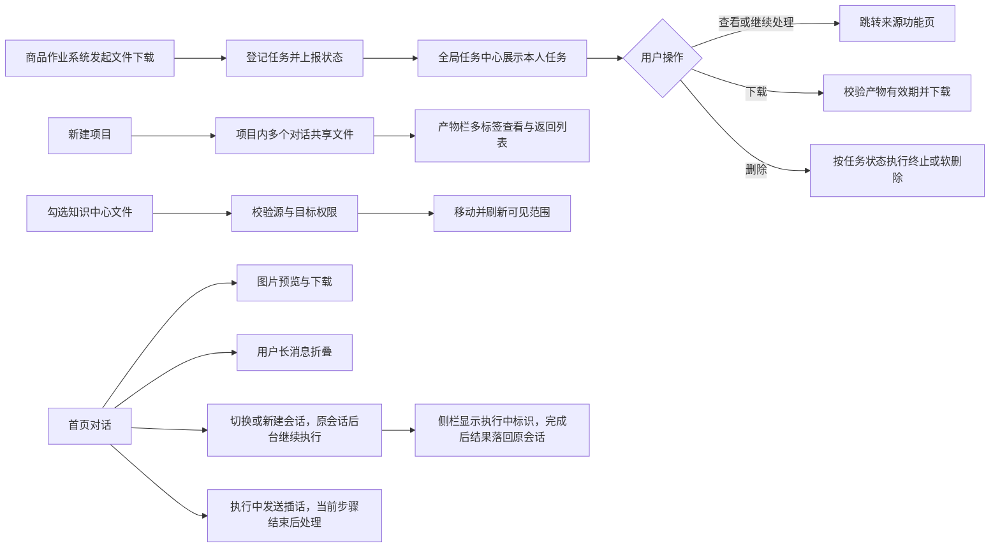
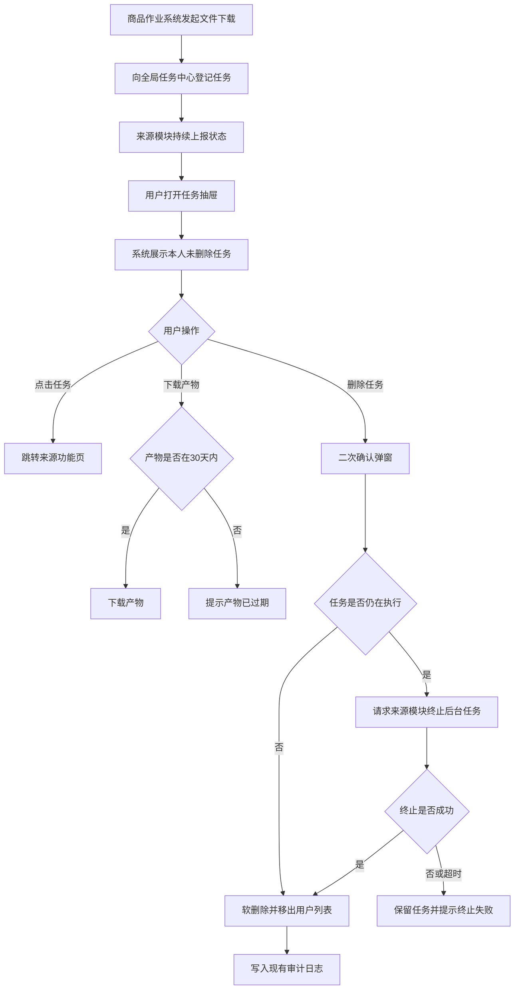
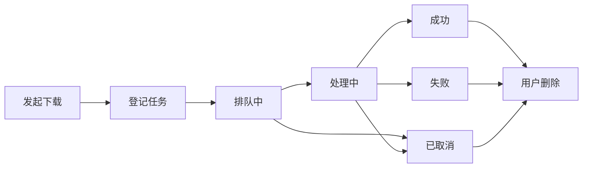
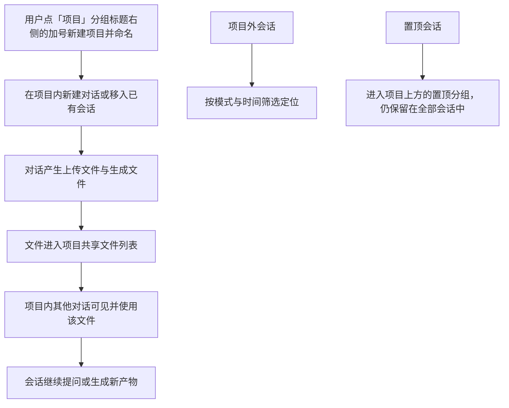
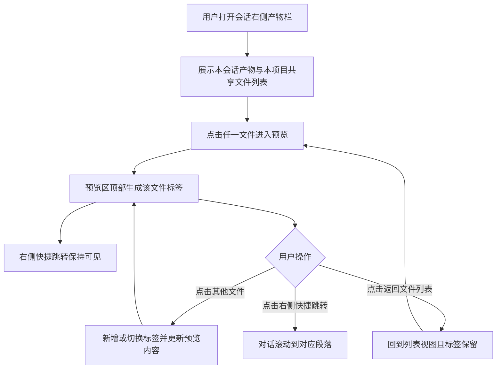
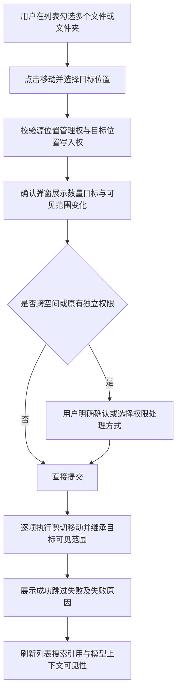
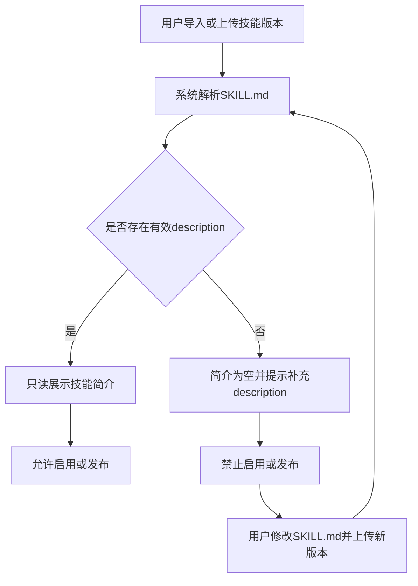
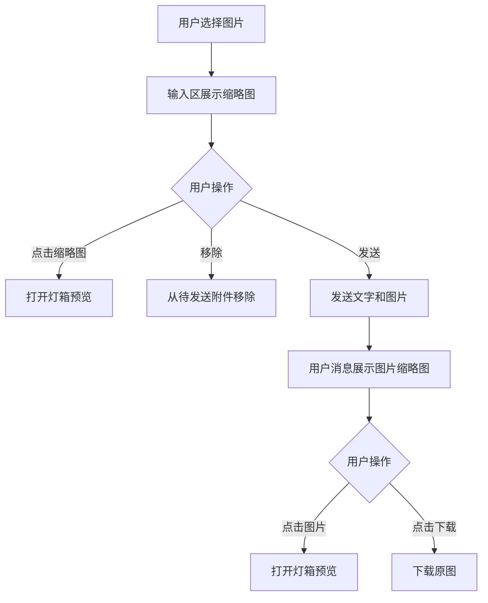
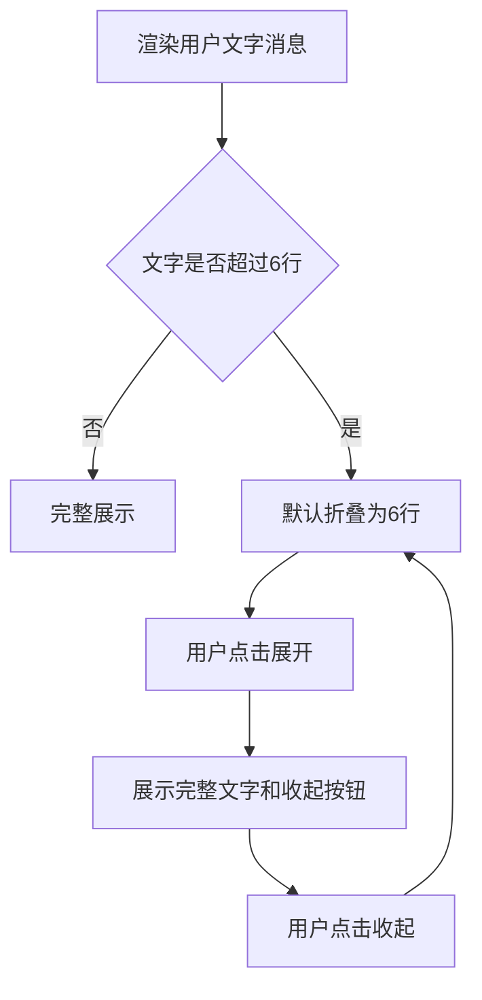
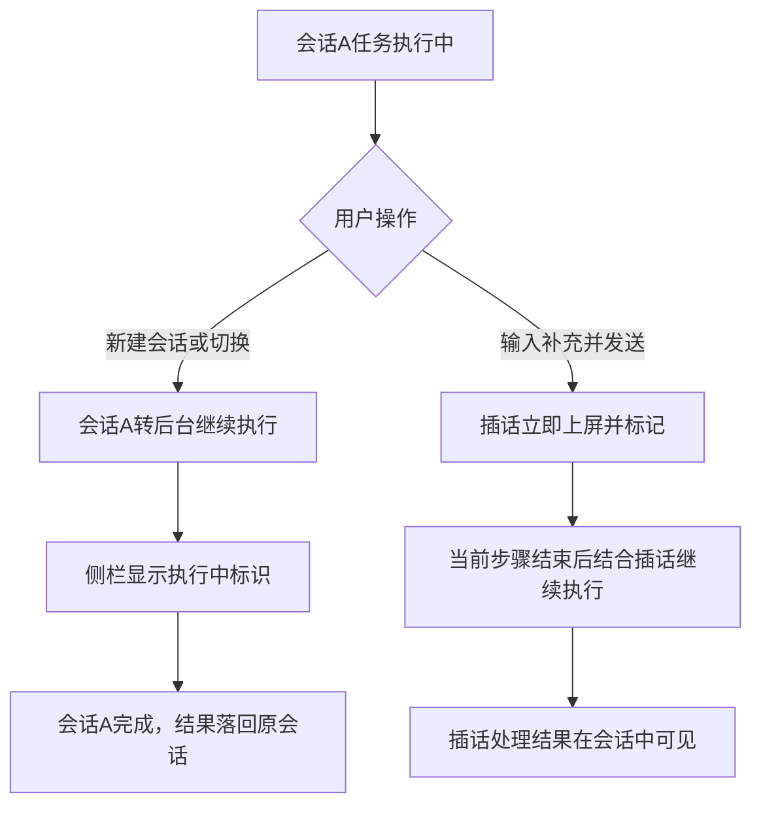

***产品需求说明书***

**天马智擎「全局任务中心改造 + 体验优化」V0.5 评审稿**

<!-- preface -->

# 版本信息

本表用于记录本文档的维护过程，请认真填写。

| **版本号** | **时间（必填）** | **状态** | **简要描述（必填）** | **部门** | **责任产品（必填）** | **批准人** |
|---|---|---|---|---|---|---|
| V0.1 | 2026-11-07 | N | 全局任务中心改造 + 体验优化初稿 | AI项目小组 |  |  |
| V0.2 | 2026-11-08 | M | 根据需求讨论修订任务删除、技能简介、公告配置、图片预览和长消息折叠规则 | AI项目小组 |  |  |
| V0.3 | 2026-11-10 | A | 新增首页对话 XMind 文件格式的配置、上传预览与后端内容解析 | AI项目小组 |  |  |
| V0.4 | 2026-11-10 | A | 新增文件预览多标签与快速跳转保留 | AI项目小组 |  |  |
| V0.5 | 2026-11-11 | M | 按规范 PRD 格式修订：任务中心本期收窄至商品作业系统文件下载，补齐公共框架、字段定义与统一状态机；新增项目模式、产物栏、知识中心移动文件与批量操作；原 M3 新功能强制查看删除；模块按 M1–M5 重排。2026-11-12 移除 V0.3 引入的 XMind 文件格式支持（M5 收窄为技能简介、图片预览、长消息折叠三项），新增 M6 智能体并行会话与任务执行中插话（会话执行状态同步纳入全局任务中心） | AI项目小组 |  |  |

注：状态可以为 N-新建、A-增加、M-更改、D-删除。V0.5 的 M3 为产物栏，与被删除的原 M3 无关。

# 关于本文档

本文按统一 PRD 模板记录已确认的需求范围、业务规则与界面要求。M1 的字段定义与状态机是本期公共底座，按产品口径描述；接口协议、排期及跨模块技术方案由评审后补充。责任产品、批准人由评审后补充。

## 术语表

| **术语** | **说明** |
|---|---|
| 全局任务中心 | 由全局悬浮球唤起的本人任务聚合抽屉 |
| 来源模块 | 实际创建并执行任务的业务模块，本期为商品作业系统 |
| 来源功能页 | 任务在来源模块中的列表、详情、结果或配置页面 |
| 任务记录 | 一次异步执行对应的状态记录 |
| 软删除 | 用户侧不再展示且不可恢复，后端永久保留，并由现有审计日志记录删除行为 |
| 产物 | 任务成功后生成或准备完成的可下载文件 |
| 项目 | 把同一件事的多个对话和共享文件收在一起的容器 |
| 项目共享文件 | 同一项目下各对话都能看到并使用的文件，本期只限本人 |
| 产物栏 | 会话右侧的文件列表与多标签预览区域 |
| 移动文件 | 把文件或文件夹从原位置剪切到目标位置，并重新计算可见范围 |
| 商品作业系统 | 本期唯一接入全局任务中心的业务系统，提供文件下载任务 |

## 参考文档

| **编号** | **文档** | **说明及地址** |
|---|---|---|
| 1 | 天马智擎「全局任务中心改造 + 体验优化」PRD V0.1 | 用户提供的需求初稿 |
| 2 | 当前前端路由 | `frontend-mvp/src/router/index.ts` |
| 3 | 知识中心现状 | `frontend-mvp/src/views/KnowledgeBaseView.vue` |
| 4 | 知识中心权限规则 | `docs/需求文档/20260903-M9-知识库细粒度权限-继承上级优化.md` |
| 5 | 首页会话侧栏现状 | `frontend-mvp/src/components/chat/source-clone/SourceChatSidebar.vue` |
| 6 | 首页对话现状 | `frontend-mvp/src/components/chat/source-clone/SourceChatDetail.vue` |
| 7 | 任务文件页现状 | `frontend-mvp/src/views/TaskFilesView.vue` |

## 沟通要求

本表记录需要跨部门沟通的事项。如果有跨部门沟通项，请填写并记录沟通结果。

| **序号** | **部门/角色** | **沟通内容** | **沟通结果** |
|---|---|---|---|
| 1 | 商品作业系统研发负责人 | 确认文件下载任务的状态上报、产物信息与后台终止能力 |  |
| 2 | 后端与存储负责人 | 确认统一 30 天下载有效期及底层文件物理删除策略 |  |
| 3 | 产品与权限负责人 | 确认移动后权限继承、可见范围变化提示的最终口径 |  |
| 4 | 后端与智能体平台负责人 | 确认会话并发的执行隔离与插话消息的处理时机（当前步骤结束后） |  |
| 5 | 项目负责人 | 确认各模块开发和上线排期 |  |

# 产品概述

## 产品概述

用户办一件事会被四个地方打断：在商品作业系统点了下载，离开页面就看不到进度、失败原因和产物，也不知道回哪儿继续；同一件事开了好几轮对话，侧栏还要按置顶、日常办公、业务专家、智能问数分组去找，材料和结论对不上；核对产物时每换一个文件都要关掉重开，看完回不到列表，预览展开后右侧快捷跳转还会消失；资料归档放错位置只能删了重传，成批整理要逐个点。此外任务执行期间整条会话是锁死的，既不能同时再让同一个智能体开一件事，中途想补充要求也只能停下重来。

本期建设全局任务中心、项目模式、产物栏和知识中心移动文件，补齐技能简介、图片预览、长消息折叠三处日常体验，并放开智能体并行会话与任务执行中插话，让「发起 → 跟进 → 拿到文件 → 归档」一条线走得完、多件事可以同时走。各模块可独立排期、独立上线。

## 产品目标

1. 用户在任意登录页面查看本人商品作业系统文件下载的进度、失败原因和产物，并能跳回来源继续处理。
2. 任务记录使用统一字段与统一状态机，后续接入知识同步、内容生成、数据导出时沿用同一套口径。
3. 一件事可以收进一个项目，项目内多个对话共用文件；侧栏分组收敛，其余会话按模式和时间筛选。
4. 产物栏支持多标签连续查看、一键返回文件列表，预览展开时右侧快捷跳转保持可用。
5. 知识中心支持移动文件与批量操作，移动前后谁能看到的资料讲清楚，失败逐项说明。
6. 技能简介以当前版本 `SKILL.md` 的 `description` 为唯一来源。
7. 首页对话支持图片发送前后预览、发送后下载原图，以及用户文字消息超过 6 行时折叠。
8. 同一智能体支持并行开展多个会话，切换或新建会话不中断原会话执行，执行状态在侧栏与全局任务中心可见。
9. 任务执行过程中可发送插话，插话立即上屏并在当前步骤结束后处理。

## 用户角色

| **用户角色** | **职责描述** | **本期权限** |
|---|---|---|
| 异步任务发起人 | 在商品作业系统发起文件下载 | 查看本人任务、筛选、下载产物、删除任务、跳转来源功能页 |
| 首页对话用户 | 在首页对话发送文字、图片和文档附件，按项目组织对话 | 新建项目、在项目内开对话、使用项目共享文件、多标签预览产物、并行开展多个会话、执行中发送插话 |
| 技能管理者 | 导入、维护、启用或发布技能 | 查看只读技能简介；在简介有效时启用或发布技能 |
| 知识库管理员、资料维护人 | 整理知识中心的文件与文件夹 | 移动文件、批量移动、批量删除；受源位置与目标位置权限约束 |
| 系统管理员 | 维护平台配置和权限 | 沿用现有权限体系，无本期新增授权入口 |

## 用户故事地图

| **用户活动** | **用户任务** | **用户故事** | **对应功能点** |
|---|---|---|---|
| 查看异步任务 | 查看本人下载任务 | 作为任务发起人，我希望在任意页面查看本人任务状态，以便不必返回来源模块反复刷新 | M1 |
| 管理异步任务 | 删除或继续处理任务 | 作为任务发起人，我希望安全删除任务或跳回来源功能页，以便继续完成业务操作 | M1 |
| 组织一件事 | 把多轮对话收进项目 | 作为首页对话用户，我希望一件事对应一个项目，以便材料和结论放在一起、接着做时不用翻侧栏 | M2 |
| 复用资料 | 项目内共享文件 | 作为首页对话用户，我希望项目下各对话共用同一批文件，以便后续对话直接接着前面的资料提问 | M2 |
| 查找会话 | 按模式和时间定位 | 作为首页对话用户，我希望非项目会话按模式和时间筛选，以便快速找到历史对话 | M2 |
| 核对产物 | 连续查看多个文件 | 作为首页对话用户，我希望用标签切换文件并可返回文件列表，以便连续核对多个产物 | M3 |
| 保持快速跳转 | 预览时继续跳转锚点 | 作为首页对话用户，我希望预览展开后右侧快捷跳转仍可点击，以便边看文件边对照回答 | M3 |
| 整理资料 | 移动放错位置的文件 | 作为知识库管理员，我希望直接移动文件并看清可见范围变化，以便不必删了重传也不越权 | M4 |
| 批量整理 | 一次处理多份资料 | 作为资料维护人，我希望勾选一批后移动或删除，并看到逐项结果 | M4 |
| 管理技能 | 查看真实技能简介 | 作为技能管理者，我希望简介自动读取技能文件，以便避免页面信息与技能内容不一致 | M5 |
| 发送图片 | 确认和回看图片 | 作为首页对话用户，我希望在发送前后预览图片，并在发送后下载原图 | M5 |
| 回看对话 | 控制长消息高度 | 作为首页对话用户，我希望长消息默认折叠，并可按需展开全文 | M5 |
| 同时推进多件事 | 并行开展多个会话 | 作为首页对话用户，我希望任务执行期间直接给同一个智能体再开会话，以便几件事同时推进、互不等待 | M6 |
| 跟进执行中的任务 | 切换会话不丢进度 | 作为首页对话用户，我希望切换会话不中断正在执行的任务，并在侧栏看到哪些会话还在执行，以便随时回来查看 | M6 |
| 执行中补充要求 | 发送插话 | 作为首页对话用户，我希望在任务执行中直接补充或修改要求，以便不必停止任务重新发起 | M6 |

## 同类产品/竞品调研（选写）

（本期留空，后续版本补充。）

# 功能需求

## 全局通用规则

| **规则项** | **说明** |
|---|---|
| 模块边界 | M1～M6 可独立排期、独立上线；任一体验优化不阻塞其他模块 |
| 任务接入 | M1 本期只接商品作业系统文件下载；其他来源按同一套登记、状态上报、来源跳转和删除闭环分批接入 |
| 历史数据 | 每类任务只登记接入生效后创建的新任务，不迁移历史任务或接入时已经运行的任务 |
| 用户数据范围 | 任务、项目、产物和知识文件都只展示当前用户有权限查看的内容 |
| 来源模块职责 | 来源模块继续负责业务配置、重试或重新发起；全局任务中心只负责查看、删除、下载和来源跳转 |
| 删除留存 | 用户删除后不提供恢复入口；后端永久保留软删除记录，并沿用现有审计日志 |
| 产物有效期 | 所有接入任务的产物下载访问统一为成功生成后 30 天 |
| 原有入口 | 来源模块已有的任务列表、任务文件页和管理员视图继续保留 |
| 合规 | 涉及资料可见范围、来源权限的操作均二次校验，失权后立即停止展示受保护内容 |

## 流程图

### 技术架构图

暂无。

### 业务流程图

## 功能模块清单

| **编号** | **功能名称** | **功能描述** | **所属模块** | **优先级** |
|---|---|---|---|---|
| M1 | 全局任务中心 | 悬浮球 + 右侧抽屉聚合本人异步任务；本期只接商品作业系统文件下载，公共框架、字段定义与状态机一次定义 | 全局前端基座、任务聚合服务 | P0-1 |
| M2 | 项目模式 | 项目容器挂多个对话和共享文件；侧栏保留项目分组，其余会话按模式、时间筛选 | 首页对话 | P1-1 |
| M3 | 产物栏 | 文件列表、多标签预览、一键返回列表，预览展开时保留右侧快捷跳转 | 首页对话 | P1-2 |
| M4 | 知识中心移动文件与批量操作 | 双端权限校验下的移动，批量移动与批量删除 | 知识中心 | P1-3 |
| M5 | 体验优化合集 | 技能简介只读、图片预览与下载、长消息折叠 | 首页对话、技能管理 | P1-4 |
| M6 | 并行会话与执行中插话 | 同一智能体并行开展多个会话，切换不中断执行，执行状态进侧栏与全局任务中心；任务执行中可发送插话 | 首页对话 | P1-5 |

## 功能详情

### M1-全局任务中心

#### 功能需求描述

商品作业系统的文件下载要等后台生成。用户点完下载通常会去做别的事，回来时只能回到原页面反复刷新，不知道是还没开始、正在生成、失败还是已经好了；失败时看不到原因，成功后也不清楚文件在哪、能留多久，多个下载混在一起更分不清。

在所有登录后的业务页面右下角提供统一任务悬浮球，点击后从页面右侧打开任务抽屉，一屏看到本人这些下载的状态、失败原因、产物和来源入口。本期业务来源只有商品作业系统文件下载这一类，字段、状态和来源接入要求按公共框架一次定义好，以后接知识同步、内容生成、数据导出沿用同一套口径；智能体会话执行任务作为平台内部来源同步纳入聚合（见 M6）。

全局任务中心提供来源跳转、未过期产物下载和任务删除，不发起下载、不提供重试按钮，也不承载来源侧的业务配置。

#### 用户角色与用户故事

作为异步任务发起人，我希望在任意页面查看本人正在排队、处理、成功、失败或已取消的下载任务；需要继续处理时可以跳转来源功能页；不再需要的任务可以安全删除。

#### 业务主流程图及说明

1. 用户在商品作业系统发起下载，来源模块创建任务后登记基本信息，并持续上报状态、失败原因、产物和来源地址。
2. 用户打开任务抽屉，系统默认按创建时间倒序展示本人未删除且当前仍有权限查看的任务，可按任务类型、状态和创建时间筛选；日期提供今日、近一周、近一月快捷范围，也可自选起止日期，选中即生效。
3. 用户点击任务行时跳转来源功能页；重试、重新发起或业务配置均在来源页面完成。
4. 用户删除终态任务时，二次确认后执行软删除并从用户侧移除。
5. 用户删除排队中或处理中的任务时，系统先真正终止后台任务；只有终止成功后才软删除。

#### 分支流程（异常流程）

- **尚未完成接入：**当商品作业系统尚未完成登记、状态上报或后台终止能力时，下载任务继续在来源模块展示，全局任务中心不生成占位数据；完成完整闭环后再接入。
- **全局登记失败：**当来源任务创建成功但登记失败时，不阻断来源任务执行，来源页面按原逻辑展示，后台继续补登记；补登记成功前全局任务中心不显示该任务。
- **状态上报中断：**当来源模块无法继续上报状态时，保留最近一次有效状态，不自行推断成功或失败；用户可跳转来源功能页查看。
- **来源侧取消：**当排队中或处理中的任务被来源侧取消时，状态更新为已取消并保留任务记录，用户可删除。
- **后台终止失败或超时：**当排队中或处理中的任务无法确认终止成功时，不删除前台记录，提示"终止失败，请稍后重试"；用户可稍后再次删除或前往来源功能页处理。
- **来源页面不可用：**当来源地址失效或对象不存在时，任务继续保留，点击后提示"来源页面不可用"，不跳转错误页面。
- **来源权限失效：**当用户失去来源模块或来源对象权限时，不再展示该任务详情和下载入口；后端记录继续保留，权限恢复后按当前数据重新查询。
- **产物过期：**当产物超过 30 天有效期时，隐藏下载按钮并提示"产物已过期，请重新发起任务"。
- **列表加载失败：**当抽屉请求失败时，保留已加载内容并提供重新加载入口，不将错误状态展示为"暂无任务"。

#### 界面原型

<!-- 示例 -->
| **动作** | **显示** | **类型** | **描述** |
|----------|----------|----------|----------|
| 【全局任务悬浮球】查看 | 进行中和失败任务数量 | 全局入口 | · 仅在登录后的业务页面展示 · 固定在页面右下角 · 数量仅统计当前用户可见任务 |
| 【全局任务悬浮球】点击 | 右侧任务抽屉 | 抽屉 | · 不跳离当前页面 · 可通过关闭按钮或遮罩关闭 |
| 【任务类型筛选】选择类型 | 对应类型任务列表 | 筛选器 | · 仅展示已接入任务类型 · 选中即生效，不设重置按钮 |
| 【任务状态筛选】选择状态 | 对应状态任务列表 | 筛选器 | · 使用统一任务状态 · 选中即生效，不设重置按钮 |
| 【时间筛选】选择时间范围 | 对应创建时间范围内的任务 | 筛选器 | · 按任务创建时间筛选 · 快捷范围：今日、近一周、近一月 · 可切到自定义范围选起止日期 |
| 【任务行】点击 | 来源功能页 | 列表行 | · 来源地址有效且用户有权限时跳转 · 来源不可用时展示提示 |
| 【下载按钮】点击下载 | 任务产物 | 按钮 | · 仅成功且产物未过期时展示 · 即时下载不登记为异步任务 |
| 【删除按钮】点击删除 | 二次确认弹窗 | 危险按钮 | · 所有任务状态均提供删除入口 · 删除成功后从用户列表移除且不可恢复 |

#### 数据说明（业务实体）

字段按业务含义定义。来源模块按同一套口径提供，后续接入的任务类型沿用，不另起一套。

<!-- 示例 -->
| **字段名** | **数据类型** | **长度** | **默认值** | **必需** | **约束说明** |
|---|---|---|---|---|---|
| 任务 ID | 字符串 |  |  | 是 | 全局唯一且稳定，用于关联状态、产物和审计日志；不面向用户展示 |
| 任务名称 | 字符串 |  |  | 是 | 一眼认出是哪次下载的可读名称，不用文件名或任务 ID 代替 |
| 任务类型 | 枚举 |  |  | 是 | 本期固定「商品作业系统文件下载」；后续按已接入类型扩展 |
| 发起人 ID | 字符串 |  |  | 是 | 用于限制只查询当前用户本人任务 |
| 来源模块 | 字符串 |  |  | 是 | 标识实际创建和执行任务的模块，本期固定商品作业系统 |
| 来源地址 | 字符串 |  |  | 是 | 指向对应来源功能页；跳转前重新校验权限 |
| 任务状态 | 枚举 |  | 排队中 | 是 | 排队中、处理中、成功、失败、已取消；由来源模块上报，中心不自行推断 |
| 进度 | 数值 |  | 空 | 否 | 仅来源模块提供可信进度时展示，没有进度就只显示状态 |
| 失败原因 | 字符串 |  | 空 | 否 | 失败时展示来源模块上报的可理解文案，不摆错误码 |
| 产物地址 | 字符串 |  | 空 | 否 | 任务成功且存在产物时提供；过期后只保留任务信息 |
| 产物失效时间 | 时间 |  | 空 | 否 | 自产物成功生成起 30 天 |
| 创建时间 | 时间 |  |  | 是 | 用于默认倒序和时间筛选 |
| 更新时间 | 时间 |  |  | 是 | 状态或产物变化时更新，用于判断任务是否有新变化 |
| 删除标记 | 布尔 |  | 否 | 是 | 用户删除成功后设为是，用户侧不再展示 |
| 删除时间 | 时间 |  | 空 | 否 | 软删除成功时记录 |

**统一任务状态机**

<!-- 示例 -->
| **状态** | **用户看到什么** | **能做什么** |
|---|---|---|
| 排队中 | 已提交，还没开始生成 | 删除（先终止后台）、回来源 |
| 处理中 | 正在生成文件，有可信进度时显示进度 | 删除（先终止后台）、回来源 |
| 成功 | 文件已好，显示剩余可取天数 | 取文件、回来源、删除 |
| 失败 | 显示来源给出的原因 | 回来源重新发起、删除 |
| 已取消 | 来源侧取消，任务还没被删除 | 删除 |

#### 业务规则和约束条件

<!-- 示例 -->
| **规则项** | **说明** |
|---|---|
| 本期接入范围 | 只接商品作业系统文件下载；其他来源按同一套接入要求分批接入 |
| 接入完成标准 | 每类任务完成登记、状态上报、来源跳转和删除闭环后，才视为完成接入 |
| 分批接入 | 具体接入顺序由研发评估；未接入任务继续使用来源模块入口 |
| 任务排序 | 默认按创建时间倒序展示 |
| 日期筛选 | 快捷范围与自定义起止日期互斥；自定义范围按任务创建时间的自然日闭区间比较，起止日期均包含 |
| 日期校验 | 两端日期都填才生效；结束日期不得早于开始日期；未填完整或顺序错误时保持原列表并给出提示；自定义范围旁提供清空入口，清空后回到全部时间 |
| 状态口径 | 统一使用排队中、处理中、成功、失败、已取消；没有可信进度时只展示状态 |
| 状态流转 | 排队中、处理中可被来源侧取消；成功、失败、已取消为终态，不回退，迟到的状态上报不把已成功的任务改回处理中 |
| 重试边界 | 全局任务中心不提供自动重试或手动重试按钮，重试或重新发起在来源功能页完成 |
| 删除规则 | 所有状态均使用删除入口；终态直接软删除，运行中先终止后台任务再软删除 |
| 删除失败 | 终止失败或结果未知时不得移除任务，避免前台消失但后台仍执行 |
| 删除留存 | 删除后用户不可恢复；后端永久保留任务和删除记录，沿用现有审计日志 |
| 下载有效期 | 所有接入任务产物自成功生成起 30 天内可下载，过期后只保留任务信息 |
| 可见范围 | 只展示本人当前有权限查看的任务；失去来源权限后不再展示详情和下载入口 |
| 原有管理入口 | 来源模块已有任务列表和管理员视图继续保留，全局中心只展示当前用户本人任务 |

#### 接口说明

来源模块需要具备四项能力：创建时登记基本信息；之后持续报告状态、失败原因、产物和来源地址；真正停止排队中或处理中的后台执行；提供可重新校验权限的来源位置。登记失败不阻断来源任务执行，补登记成功后任务中心才显示。上述闭环全部具备才算完成接入。

本期只接商品作业系统文件下载。其他来源按同一要求分批接入，不迁移接入前历史任务，接入时已经在跑的任务也不补登。未接入的任务继续在各自模块查看。具体接口协议由研发技术方案定义，不在产品需求阶段预设字段协议。

#### AI 链路说明（可选）

本期任务状态与产物均由来源模块上报，不涉及模型推理链路。后续接入内容生成类任务时，再按本模板补充解析、生成与重试说明。
### M2-项目模式

#### 功能需求描述

现在侧栏把会话分成置顶、日常办公、业务专家、智能问数四组，同一个会话要被「模式」和「置顶」归两次；一件事分几轮问下来，前面上传的资料、中间生成的文件、最后一版结论散在不同会话里，想接着做只能靠翻标题猜。

新增项目作为组织容器：一个项目下可以开多个对话，这些对话共用同一批文件。侧栏自上而下为「置顶」「项目」「全部会话」：置顶保留独立分组并放在项目上方，项目分组是组织容器，其余会话合成一组按模式和时间范围筛选，已置顶的会话仍留在该组内并排在前面。项目不参与模式枚举，日常办公、业务专家、智能问数仍是会话属性。日期筛选提供今日、近一周、近一月、更早的快捷范围，也支持自选起止日期。

#### 用户角色与用户故事

作为首页对话用户，我希望一件事对应一个项目，项目里的对话和文件放在一起，接着做时不用翻侧栏重新找材料和结论；查找项目外的历史对话时，可以按模式和创建时间快速筛选。

#### 业务主流程图及说明

1. 用户新建项目并起名字；在项目里开对话，对话照旧按日常办公、业务专家或智能问数模式使用。
2. 项目里的对话共享同一批文件：上传的、对话生成的、从产物栏保存进来的，项目内每个对话都能看到并拿来继续问。
3. 已有会话可移入项目；移出后不再共享项目文件，会话本身保留。
4. 侧栏自上而下为置顶、项目、全部会话；置顶是独立分组且位于项目上方，其余会话合成一组，组内按模式（日常办公 / 业务专家 / 智能问数）和时间范围筛选，日期可用快捷范围或自定义起止日期，已置顶会话仍在该组内并排序靠前。

#### 分支流程（异常流程）

- **项目内无对话：**新建项目后还没有对话时，项目卡片展示空状态并提供「新建对话」入口；项目本身保留。
- **移入前共享提示：**当会话被移入项目时，先说明该项目将共享哪些文件；用户确认后才建立归属关系。
- **移出后文件不可用：**当会话移出项目时，该项目共享文件不再出现在会话中；会话自己上传或生成的文件继续保留。
- **共享文件无权限：**当项目共享文件来自知识中心且用户已失去查看权限时，文件不展示、不进入检索和模型上下文，其余对话不受影响。
- **删除项目：**当用户删除项目时，二次确认并提示项目内对话和文件数量；默认只解除组织关系，对话和文件保留。
- **同名项目：**当项目名重复时允许创建，卡片按最近更新时间区分；不做重名拦截。
- **筛选无结果：**当模式和时间组合没有匹配会话时，展示空状态提示调整筛选条件，不影响项目分组。

#### 界面原型

<!-- 示例 -->
| **动作** | **显示** | **类型** | **描述** |
|---|---|---|---|
| 【新建项目】点击 | 项目卡片 / 分组 | 图标按钮 | · 入口在「项目」分组标题右侧的加号，不占用侧栏顶部菜单 · 侧栏「项目」分组内按最近更新排序 · 必填项目名称 |
| 【进入项目】点击 | 对话列表 + 共享文件 | 项目页 | · 可继续新建对话，也可移入已有会话 · 共享文件与 M3 产物栏使用同一批数据 |
| 【模式 / 时间筛选】选择 | 对应会话列表 | 筛选器 | · 作用于非项目会话组 · 模式含日常办公、业务专家、智能问数 · 日期含快捷范围与自定义起止日期 · 选中即生效，不设重置按钮 |
| 【置顶】点击 | 会话进入项目上方的「置顶」分组 | 图标按钮 | · 全部会话组内仍保留该项并排序靠前 · 取消置顶后从置顶分组移除 |
| 【移入 / 移出项目】操作 | 归属变化确认 | 弹窗 | · 说明将共享或不再共享哪些文件 |
| 【删除项目】点击 | 二次确认弹窗 | 危险按钮 | · 提示项目内对话和文件数量 · 默认保留对话和文件 |

#### 数据说明（业务实体）

<!-- 示例 -->
| **字段名** | **数据类型** | **长度** | **默认值** | **必需** | **约束说明** |
|---|---|---|---|---|---|
| 项目 ID | 字符串 |  |  | 是 | 全局唯一且稳定，用于关联对话和共享文件 |
| 项目名称 | 字符串 |  |  | 是 | 用户可修改；允许同名，按最近更新时间区分 |
| 所属用户 ID | 字符串 |  |  | 是 | 本期项目只属于创建者本人 |
| 项目内对话列表 | 列表 |  | 空 | 否 | 记录归入本项目的会话 ID |
| 共享文件列表 | 列表 |  | 空 | 否 | 项目内各对话共用的文件 ID，按知识中心权限过滤 |
| 创建时间 | 时间 |  |  | 是 | 项目创建时记录 |
| 最近更新时间 | 时间 |  |  | 是 | 对话或共享文件变化时更新，用于分组排序 |
| 会话归属项目 ID | 字符串 |  | 空 | 否 | 空表示不属于任何项目 |
| 会话模式 | 枚举 |  | 日常办公 | 是 | 日常办公、业务专家、智能问数；项目不参与该枚举 |
| 会话置顶标记 | 布尔 |  | 否 | 是 | 决定是否进入「置顶」分组，并影响全部会话组内排序 |
| 会话创建时间 | 时间 |  |  | 是 | 时间范围筛选依据；自定义范围按自然日闭区间比较 |
| 自定义时间范围 | 时间区间 |  | 空 | 否 | 开始日期、结束日期；两端均包含，结束日期不得早于开始日期 |

#### 业务规则和约束条件

<!-- 示例 -->
| **规则项** | **说明** |
|---|---|
| 项目与模式 | 项目按容器组织，不参与模式枚举；日常办公、业务专家、智能问数仍是会话属性 |
| 分组规则 | 侧栏自上而下为置顶、项目、全部会话；置顶保留独立分组且位于项目上方，其余会话合成一组 |
| 筛选规则 | 非项目会话组按模式和时间范围筛选；日期可用快捷范围或自定义起止日期，选中即生效，不设重置按钮 |
| 日期校验 | 与全局任务中心同一套口径：两端日期都填才生效，结束日期不得早于开始日期，未填完整时保持原列表并提示 |
| 共享范围 | 只限本人同一项目下的多个对话；本期不做成员邀请和跨用户授权 |
| 共享内容 | 项目内上传的、对话生成的、从产物栏保存进来的文件；与 M3 产物栏同一批数据 |
| 文件权限 | 来自知识中心的资料仍按知识中心权限校验，无权时不展示、不进检索和模型上下文 |
| 移入移出 | 移入前说明将共享哪些文件；移出后该项目文件不再出现在会话中，会话本身保留 |
| 删除项目 | 二次确认并提示项目内对话和文件数量；默认只解除组织关系，对话和文件保留 |
| 与产物栏 | 项目共享文件与 M3 产物栏「本项目共享文件」分组使用同一批数据 |
| 范围边界 | 本期不做项目成员协作、项目级权限配置、跨项目文件汇总 |

#### 接口说明

需要支持项目创建、重命名、删除与列表读取，会话归属变更，以及项目共享文件列表读取；共享文件列表沿用现有附件与知识中心权限校验能力。具体接口协议由研发技术方案定义，不在产品需求阶段预设字段协议。

#### AI 链路说明（可选）

项目共享文件进入对话上下文前按当前用户权限过滤，无查看权限的内容不进入检索与模型上下文；本期不改变对话模型、编排轮次与澄清卡逻辑。

### M3-产物栏

#### 功能需求描述

预览一个文件后想看第二个，得先关掉再回列表重新点开；看完找不到回列表的入口；预览一展开，对话右侧用来跳到各段内容的快捷按钮被隐藏了，边看文件边对照回答就用不了。当前前端原型里预览展开时右侧锚点栏被隐藏，V0.4 把位置写成了左侧，本期一并纠正。

会话右侧产物栏默认显示文件列表，分「本会话产物」和「本项目共享文件」两组；打开的文件用标签挂着，切换不用关；任何预览状态下都能一键回列表；右侧快捷跳转在预览展开时保持可见可点。独立「任务文件」页保持原样。

文件区是会话页右侧并排的一列，打开时对话区随之收窄，用浮层盖住对话会让对照看回答变得麻烦。列表态窄列约 380px，预览展开后按阅读需要加宽，同时保证对话列仍有可读宽度。顶部显示文件名、创建时间、下载和关闭；HTML 类按报告版式呈现（品牌切换、时间筛选条、指标口径、概览指标卡），数据上涨用红色、下跌用绿色。报告时间筛选除日、周、月快捷范围外支持自选起止日期，应用后显示统计范围。返回文件列表或关闭后回到窄列。

会话右侧的消息导航轨在文件区打开和预览加宽时都保留，贴着对话列右缘，形态是一条窄轨上的短横标记：每条提问、每段内容各对应一个短横，悬停浮出预览卡显示各条内容摘要、当前这行加粗，点击滚到对应位置。打开文件区的入口放在轨道顶部的小按钮上，再次点击收起。

#### 用户角色与用户故事

作为首页对话用户，我希望在预览中通过标签切换文件并一键返回文件列表，还能在预览展开时继续使用右侧快捷跳转，以便连续核对多个产物、边看文件边对照回答。

#### 业务主流程图及说明

1. 会话右侧产物栏默认显示文件列表，分「本会话产物」和「本项目共享文件」两组。
2. 点任一文件进入预览，顶部出现该文件的标签；再点其他文件直接切换或新增标签，预览保持展开。
3. 点「返回文件列表」回到列表，已打开的标签保留，可再切回去。
4. 预览展开期间，右侧快捷跳转按钮保持可见；点击后对话滚到对应段落。

#### 分支流程（异常流程）

- **只有一个文件：**当本次只有单个文件可预览时，仍展示当前文件标签和返回列表入口，不摆无意义的空标签。
- **文件已失效：**当切换到的文件不可访问或已失效时，标签保留，预览区提示不可预览或加载失败，用户可切换到其他文件、重试或返回列表。
- **预览加载失败：**当目标文件加载失败时，标签保持不变，预览区提示加载失败并提供重新加载；失败不影响切换其他标签。
- **快捷跳转目标缺失：**当快捷跳转对应的锚点在当前回答中不存在时，按钮置为不可用或点击后提示无对应内容，不跳转到错误位置。
- **窄屏窗口：**当窗口宽度不足以同时容纳对话、预览和快捷跳转时，快捷跳转折叠为可展开入口，展开后仍可跳转，不直接隐藏。
- **项目共享文件无权限：**当项目共享文件因权限变化不可见时，从列表移除；已打开的标签保留并提示无查看权限。
- **关闭预览：**当用户关闭预览时还原对话区宽度，右侧快捷跳转继续可用。

#### 界面原型

<!-- 示例 -->
| **动作** | **显示** | **类型** | **描述** |
|---|---|---|---|
| 【打开产物栏】查看 | 分组文件列表 | 侧栏 | · 本会话产物 + 本项目共享文件 · 与 M2 项目共享文件同一批数据 |
| 【点文件】点击 | 预览 + 文件标签 | 标签栏 | · 标签栏位于预览区顶部 · 当前标签有选中态 |
| 【预览展开】查看 | 加宽的并排侧栏 + 文件信息条 | 侧栏 | · 展开后加宽，对话区同步收窄，不用浮层覆盖对话 · 顶部显示文件名、创建时间、下载、关闭 · 返回列表或关闭后回到窄列 |
| 【HTML 报告】查看 | 报告版式 | 预览内容 | · 品牌切换、时间范围、指标口径、概览指标卡 · 环比上涨标红、下跌标绿 |
| 【报告自定义范围】选择起止日期 | 统计范围条 + 范围标签 | 日期选择 | · 日、周、月快捷范围之外可自选起止日期 · 应用后展示统计范围，取消不改当前范围 |
| 【点其他标签】点击 | 切换预览内容 | 标签 | · 不关闭预览、不改变对话滚动位置 |
| 【返回文件列表】点击 | 列表视图 | 按钮 | · 一键返回，已打开标签保留 |
| 【展开任务文件】点击 | 文件区一列 | 图标按钮 | · 位于会话右上角、导航轨顶部 · 再次点击收起文件区 |
| 【消息导航轨】查看 | 窄轨 + 短横标记 | 导航轨 | · 每条提问、每段内容一个短横，贴在对话列右缘 · 悬停浮出预览卡，当前行加粗 |
| 【短横标记】点击 | 对话滚动到对应内容 | 按钮 | · 目标缺失时不跳转 |
| 【关闭预览】点击 | 还原对话区宽度 | 按钮 | · 右侧快捷跳转继续可用 |

#### 数据说明（业务实体）

沿用首页对话现有预览与引用数据模型，新增标签与列表归属信息。

<!-- 示例 -->
| **字段名** | **数据类型** | **长度** | **默认值** | **必需** | **约束说明** |
|---|---|---|---|---|---|
| 预览标签 ID | 字符串 |  |  | 是 | 每条预览标签的唯一标识 |
| 标签类型 | 枚举 |  | 文件 | 是 | 文件、返回文件列表入口 |
| 关联文件 ID | 字符串 |  | 空 | 否 | 文件标签关联的附件唯一标识 |
| 文件分组 | 枚举 |  | 本会话产物 | 是 | 本会话产物、本项目共享文件；决定列表归属 |
| 选中状态 | 布尔 |  | 否 | 是 | 同一时间只有一个标签处于选中态 |
| 预览加载状态 | 枚举 |  | 待加载 | 是 | 待加载、加载中、成功、失败、不可预览 |
| 快捷跳转可用状态 | 布尔 |  | 是 | 是 | 预览展开期间保持可用，目标缺失时置为不可用 |
| 导航锚点项 | 集合 |  |  | 是 | 每个短横对应一条提问或一段内容，含跳转目标、预览摘要与顺序 |
| 报告统计范围 | 时间区间 |  | 日 | 否 | 快捷范围或自定义起止日期；应用后在报告内展示 |

#### 业务规则和约束条件

<!-- 示例 -->
| **规则项** | **说明** |
|---|---|
| 列表范围 | 文件列表包含本会话产物与本项目共享文件，分组展示 |
| 标签范围 | 当前文件、其余可预览文件、返回文件列表入口；同一时间只有一个标签选中 |
| 切换行为 | 切换标签只更新预览内容，不关闭预览、不改变对话滚动位置 |
| 返回列表 | 一键返回列表视图，已打开的标签保留，可再次切回 |
| 快捷跳转 | 消息导航轨在文件区打开与预览加宽时均保留，始终贴在对话列右缘；形态为窄轨短横，悬停出预览卡，点击滚到对应位置 |
| 文件区宽度 | 文件区是并排的一列，列表态约 380px，预览展开后加宽并保证对话列仍有可读宽度，返回列表或关闭后恢复窄列 |
| 文件信息条 | 预览态顶部显示文件名、创建时间、下载、关闭；列表态显示产物栏标题 |
| 报告时间范围 | 日、周、月快捷范围与自定义起止日期互斥；结束日期不得早于开始日期，应用后显示统计范围；切换快捷范围时清除自定义范围 |
| 窄屏 | 宽度不够时快捷跳转折叠为可展开入口，不直接隐藏 |
| 失效处理 | 文件失效或加载失败时保留标签并提供切换、重试与返回路径 |
| 权限 | 项目共享文件按知识中心权限过滤，失权后从列表移除并提示 |
| 范围边界 | 本期不做同屏并排对比；独立「任务文件」页保持原样 |

#### 接口说明

沿用首页对话现有预览、引用与附件数据接口，不新增接口要求；标签切换复用现有已返回的文件与目录信息，项目共享文件复用 M2 的文件列表能力。具体协议由技术方案定义。

#### AI 链路说明（可选）

本期只调整文件查看方式，不涉及模型推理链路；已打开的文件内容仍按现有对话引用规则进入上下文。

### M4-知识中心移动文件与批量操作

#### 功能需求描述

文件放错文件夹，只能删掉重新上传，解析和索引要重跑一遍，引用过它的对话也可能跟着失效；一次要整理几十份资料时逐个操作很慢。更麻烦的是移动会改变谁能看到这份资料：公共空间和个人空间的可见范围不同，文件夹还有各自的授权，稀里糊涂拖过去容易把敏感资料开放给不该看的人。

在知识中心列表支持勾选多个文件或文件夹后移动到目标位置，确认弹窗把移动数量、目标位置和可见范围变化讲明白，提交后逐项列出成功、跳过和失败；同一批选中项也可批量删除。

#### 用户角色与用户故事

作为知识库管理员或资料维护人，我希望把放错位置的文件直接移动到正确位置，并在批量整理时看清每一项的结果与权限变化，以便归档不丢内容、不越权。

#### 业务主流程图及说明

1. 在列表里勾选多个文件或文件夹，点「移动」，选目标位置。
2. 确认弹窗列出本次移动数量、目标位置、可见范围变化；涉及跨空间或原有独立权限时，需要明确确认。
3. 提交后看逐项结果：成功的出现在目标位置，失败的留在原地并写明原因。
4. 同一批选中项也可批量删除，二次确认后执行。

#### 分支流程（异常流程）

- **源无管理权：**当用户对源位置没有管理权时，该项跳过并说明原因，其余项继续处理。
- **目标不可写：**当用户对目标位置没有写入权时，该项失败并留在原地；目标位置选择器只列本人有写入权的位置。
- **原有独立权限：**当文件原本取消继承、单独设过可见范围时，移动前提示「原有可见范围不会带过去」，让用户选「跟随目标」或「保留原设置」，默认跟随目标。
- **跨空间移动：**当移动发生在个人空间与公共空间之间时，二次确认并列出移动前后谁能看到的变化；可能扩大可见范围时不允许静默执行。
- **移入自身或子文件夹：**当目标位置是选中项自身或其子文件夹时，拦截该项并说明原因，其余项继续处理。
- **目标重名：**当目标已有同名文件时，提示加（2）或跳过，不覆盖原文件。
- **并发冲突：**当目标配置已被他人更新时，拒绝覆盖较新的配置，提示刷新后重试。
- **部分失败：**当一批中部分项失败时，成功的照常生效，失败的留在原地，不整批回滚，也不整批标记成功。
- **权限变化后引用失效：**当移动后用户失去查看权限时，列表、搜索、引用和模型上下文不再展示该内容；已被对话或项目引用的文件仍可打开，但按新位置权限重新校验。

#### 界面原型

<!-- 示例 -->
| **动作** | **显示** | **类型** | **描述** |
|---|---|---|---|
| 【列表多选】勾选 | 勾选框与已选数量 | 列表 | · 支持跨页保留本批选择，取消选择可清空 |
| 【移动】点击 | 目标位置选择 | 弹窗 | · 只列本人有写入权的位置 |
| 【确认弹窗】查看 | 数量、目标、可见范围变化 | 确认弹窗 | · 跨空间或原有独立权限时必须明确确认 |
| 【提交结果】查看 | 逐项成功 / 跳过 / 失败 | 结果列表 | · 失败写明原因（无权限、重名、目标不可写、并发冲突） · 失败项可单独重试 |
| 【批量删除】点击 | 二次确认弹窗 | 危险按钮 | · 说明删除后不可恢复 |
| 【权限提示】查看 | 移动前后谁能看到 | 说明卡片 | · 列出可见范围变化，不静默执行 |

#### 数据说明（业务实体）

<!-- 示例 -->
| **字段名** | **数据类型** | **长度** | **默认值** | **必需** | **约束说明** |
|---|---|---|---|---|---|
| 操作批次 ID | 字符串 |  |  | 是 | 一次批量移动或删除的唯一标识，用于逐项结果回显 |
| 选中项列表 | 列表 |  |  | 是 | 文件或文件夹 ID，记录源位置 |
| 源位置 ID | 字符串 |  |  | 是 | 用于校验管理权与判断是否跨空间 |
| 目标位置 ID | 字符串 |  |  | 是 | 用于校验写入权与继承可见范围 |
| 源权限快照 | 枚举 |  |  | 是 | 记录移动前可见范围，用于变化提示 |
| 目标可见范围 | 枚举 |  |  | 是 | 沿用「继承上级」规则计算 |
| 权限处理选择 | 枚举 |  | 跟随目标 | 是 | 跟随目标、保留原设置 |
| 逐项结果 | 枚举 |  |  | 是 | 成功、跳过、失败 |
| 失败原因 | 字符串 |  | 空 | 否 | 无权限、重名、目标不可写、并发冲突等可理解文案 |
| 操作人 ID | 字符串 |  |  | 是 | 用于审计留痕 |
| 操作时间 | 时间 |  |  | 是 | 提交时记录 |

#### 业务规则和约束条件

<!-- 示例 -->
| **规则项** | **说明** |
|---|---|
| 双端校验 | 对源位置要有管理权、对目标位置要有写入权；任一不满足，该项留在原地并说明原因 |
| 剪切语义 | 移动按剪切执行，不产生第二份文件 |
| 默认继承 | 移动后默认跟随目标文件夹的可见范围，沿用「继承上级」规则 |
| 原有独立权限 | 原本取消继承、单独设过可见范围的文件，移动前必须提示并选择处理方式，默认跟随目标 |
| 跨空间移动 | 个人空间与公共空间之间移动要二次确认，并列出移动前后谁能看到的变化；可能扩大可见范围时不允许静默执行 |
| 检索与引用 | 权限变化后同步刷新列表、搜索、引用和模型上下文的可见性；无查看权限的内容不出现 |
| 引用不失效 | 移动不改变文件内容，已被对话或项目引用的文件仍可打开，但按新位置权限重新校验 |
| 文件夹限制 | 不能移入自身或其子文件夹 |
| 重名处理 | 目标已有同名时提示加（2）或跳过，不覆盖 |
| 并发冲突 | 拒绝覆盖较新的配置，提示刷新后重试 |
| 本期批量范围 | 批量移动、批量删除；批量改权限、批量重命名、批量下载不在本期 |
| 逐项结果 | 成功、跳过、失败分别列出；部分失败时成功的照常生效，失败的留在原地 |
| 删除 | 批量删除二次确认后执行，删除后不可恢复，沿用现有审计日志 |

#### 接口说明

需要支持目标位置可选列表读取、源与目标权限校验、批量移动、批量删除和逐项结果返回；权限计算沿用知识中心现有「继承上级」与可见范围能力。具体接口协议由研发技术方案定义，不在产品需求阶段预设字段协议。

#### AI 链路说明（可选）

移动后权限变化需同步刷新检索索引与模型上下文的可见性：无查看权限的文件不进入检索结果与对话上下文；已引用文件按新位置权限重新校验。
### M5-体验优化合集

#### 功能需求描述

三处日常体验各卡在一个小地方：管理页写的技能简介和技能文件对不上，按简介判断能力容易出错；图片发之前看不清选了哪张，发完想放大或拿原图都要绕；自己写的长问题占满屏，压住后面的回答。

本期把技能简介只读、图片预览与下载、长消息折叠合并为一个体验优化模块，三项共用首页对话与技能管理的现有链路，可独立排期、独立上线。

| **小项** | **用户现在卡在哪** | **做完有什么不同** | **面向谁** |
|---|---|---|---|
| 技能简介只读 | 管理页简介与技能文件不一致 | 简介自动读取当前版本，不能启用或发布的技能一眼可辨 | 技能管理者 |
| 图片预览与下载 | 发之前看不清，发完想放大或拿原图不方便 | 发送前缩略图可放大可移除，发送后灯箱预览并可下载原图 | 首页对话用户 |
| 长消息折叠 | 长问题占满屏 | 超过 6 行默认折叠，可展开或收起 | 首页对话用户 |

**技能简介只读**

技能管理中的简介不再由用户手动输入，统一读取技能包根目录 `SKILL.md` 的 YAML front matter 中的 `description`。智能体简介不在本次范围内，继续沿用现有逻辑。

**图片预览与下载**

本期只改造首页对话的图片上传场景。用户选择图片后，在发送前看到缩略图并可放大或移除；发送成功后，用户消息继续展示图片缩略图，可点击进入灯箱预览并下载原图。

不提供鼠标悬浮大图，统一通过点击缩略图打开灯箱。

**长消息折叠**

首页对话中的用户文字消息超过实际渲染的 6 行时默认折叠。折叠态展示约 6 行高度、尾部渐变遮罩和“展开”按钮；展开后展示完整文字，并提供“收起”按钮。

只处理用户文字，不折叠 AI 回复，也不把图片、文件等附件高度计入 6 行判断。

#### 用户角色与用户故事

**技能简介只读**

作为技能管理者，我希望系统自动展示当前技能版本的真实描述，避免管理页面简介与技能文件不一致。

**图片预览与下载**

作为首页对话用户，我希望在发送前确认选中的图片，并在发送后继续放大查看或下载原图，避免发错图片或无法回看附件。

**长消息折叠**

作为首页对话用户，我希望较长的本人消息默认占用较少空间，以便快速回看后续回答；需要核对原文时可以展开全文。

#### 业务主流程图及说明

**技能简介只读**

1. 用户导入或上传技能版本后，系统解析根目录 `SKILL.md`。
2. 存在有效 `description` 时，页面只读展示并允许启用或发布。
3. 缺失或解析失败时，技能版本可以保存，但不能启用或发布。

**图片预览与下载**

1. 用户选择图片后，输入区展示待发送缩略图。
2. 用户可以点击缩略图预览、移除图片或发送消息。
3. 发送成功后，用户消息中继续展示缩略图，并提供灯箱预览和原图下载。

**长消息折叠**

1. 系统按消息当前实际渲染行数判断是否超过 6 行。
2. 不超过 6 行时完整展示；超过 6 行时默认折叠。
3. 每条消息独立展开或收起，状态只在当前页面会话中保留。

#### 分支流程（异常流程）

**技能简介只读**

- **缺少 \`description\`：**当新导入或新版本缺少有效描述时，允许保存，简介保持为空并提示“请在 SKILL.md 中补充 description”；补齐并上传新版本后恢复启用或发布。
- **文件解析失败：**当 `SKILL.md` 无法解析时，保留当前已发布版本的可见信息，新版本不得启用或发布；修复文件并上传新版本后重新解析。
- **存量技能兼容：**本需求上线前已经启用或发布但缺少有效 `description` 的技能继续保持可用；下一次上传新版本、重新启用或重新发布时执行新校验。

**图片预览与下载**

- **图片选择失败：**当图片不符合首页现有格式、数量或大小限制时，不生成缩略图并展示现有错误提示；用户重新选择后恢复。
- **本地预览失败：**当选中图片无法读取时，从待发送附件移除并提示重新选择。
- **发送失败：**当消息发送失败时，待发送图片保留在输入区，用户可以再次发送或移除。
- **历史图片失效：**当消息图片资源失效时，展示不可用占位和“图片已失效”，不展示下载按钮。
- **下载失败：**当原图下载失败时，保留当前预览状态并提示“下载失败，请稍后重试”；用户可再次下载。

**长消息折叠**

- **窗口宽度变化：**当页面尺寸变化时，系统按新的实际渲染行数重新判断；已展开消息在当前页面会话中保持展开，除非用户主动收起。
- **消息不足 6 行：**当文字不超过 6 行时完整展示，不出现渐变遮罩、展开或收起按钮。
- **消息包含附件：**当用户消息同时包含附件时，只计算文字区域行数，附件继续按原规则完整展示。

#### 界面原型

**技能简介只读**

<!-- 示例 -->
| **动作** | **显示** | **类型** | **描述** |
|----------|----------|----------|----------|
| 【技能简介】查看 | 当前版本 `description` | 只读文本 | · 不展示手动输入框 · 内容随当前技能版本更新 |
| 【缺失简介提示】查看 | 请在 SKILL.md 中补充 description | 校验提示 | · 缺失时简介显示为空 · 明确说明修复位置 |

**图片预览与下载**

<!-- 示例 -->
| **动作** | **显示** | **类型** | **描述** |
|----------|----------|----------|----------|
| 【上传图片入口】选择图片 | 输入区图片缩略图 | 附件 | · 沿用首页现有上传限制 · 展示必要的文件信息 |
| 【发送前图片缩略图】点击 | 灯箱预览 | 图片 | · 不依赖鼠标悬浮 · 支持关闭按钮、遮罩或 Esc 关闭 |
| 【移除按钮】点击移除 | 图片从待发送区移除 | 图标按钮 | · 仅移除当前图片 · 不影响其他附件 |
| 【发送按钮】点击发送 | 用户消息和图片缩略图 | 按钮 | · 发送成功后清空待发送图片 · 发送失败时保留图片 |
| 【消息图片缩略图】点击 | 灯箱预览原图 | 图片 | · 保持图片原始比例 · 超出视口时按比例缩放 |

**长消息折叠**

<!-- 示例 -->
| **动作** | **显示** | **类型** | **描述** |
|----------|----------|----------|----------|
| 【用户长消息】查看 | 6 行文字、渐变遮罩和展开按钮 | 消息气泡 | · 仅文字超过 6 行时折叠 · 每条消息独立判断 |
| 【展开按钮】点击展开 | 完整用户消息和收起按钮 | 文本按钮 | · 展开状态只作用于当前消息 |

#### 数据说明（业务实体）

**技能简介只读**

<!-- 示例 -->
| **字段名** | **数据类型** | **长度** | **默认值** | **必需** | **约束说明** |
|-------------|----------------|----------|-------------|----------|----------------|
| 技能版本 ID | 字符串 |  |  | 是 | 标识当前解析的技能版本 |
| 技能简介 | 字符串 |  | 空 | 否 | 只读取当前版本 `SKILL.md` YAML front matter 中的非空字符串 `description` |

**图片预览与下载**

<!-- 示例 -->
| **字段名** | **数据类型** | **长度** | **默认值** | **必需** | **约束说明** |
|-------------|----------------|----------|-------------|----------|----------------|
| 附件 ID | 字符串 |  |  | 是 | 沿用现有附件唯一标识 |
| 文件名 | 字符串 |  |  | 是 | 用于展示和下载文件命名 |
| 文件类型 | 字符串 |  |  | 是 | 用于识别图片资源并沿用现有上传校验 |
| 预览地址 | 字符串 |  |  | 是 | 用于发送前后缩略图和灯箱预览 |
| 原图下载地址 | 字符串 |  |  | 是 | 用于发送后的原图下载 |

**长消息折叠**

<!-- 示例 -->
| **字段名** | **数据类型** | **长度** | **默认值** | **必需** | **约束说明** |
|-------------|----------------|----------|-------------|----------|----------------|
| 消息 ID | 字符串 |  |  | 是 | 沿用现有消息唯一标识，用于区分每条消息的页面状态 |
| 发送方类型 | 枚举 |  |  | 是 | 仅用户消息适用折叠，AI 回复不适用 |
| 消息文字 | 字符串 |  |  | 是 | 按实际渲染行数判断，不按字符数判断 |

#### 业务规则和约束条件

**技能简介只读**

<!-- 示例 -->
| **规则项** | **说明** |
|-------------|----------|
| 唯一来源 | 技能简介以当前版本 `SKILL.md` YAML front matter 中的 `description` 为唯一来源 |
| 编辑限制 | 技能管理页面不提供简介编辑入口 |
| 发布限制 | 缺少有效 `description` 的技能可以保存，但不得启用或发布 |
| 存量兼容 | 已启用或已发布的存量技能不立即停用；下一次版本或发布操作时执行新校验 |

**图片预览与下载**

<!-- 示例 -->
| **规则项** | **说明** |
|-------------|----------|
| 场景范围 | 仅首页对话的图片上传和用户消息展示 |
| 发送前能力 | 缩略图、点击灯箱和移除 |
| 发送后能力 | 缩略图、点击灯箱和下载原图 |
| 灯箱关闭 | 支持关闭按钮、点击遮罩和 Esc |
| Hover | 不提供悬浮大图 |

**长消息折叠**

<!-- 示例 -->
| **规则项** | **说明** |
|-------------|----------|
| 适用消息 | 首页对话中的用户文字消息 |
| 折叠阈值 | 实际渲染超过 6 行时折叠，不按字符数判断 |
| 默认状态 | 每次进入页面时，符合条件的消息默认折叠 |
| 独立状态 | 每条消息独立展开或收起 |

#### 接口说明

**技能简介只读**

技能上传或版本解析结果需要返回 `description` 和解析状态；具体协议沿用现有技能管理接口扩展，不在产品需求阶段定义。

**图片预览与下载**

沿用首页对话附件上传和消息接口。服务端需要保证发送后的图片消息可返回有效预览资源和原图下载资源；具体资源协议由技术方案定义。

**长消息折叠**

无新增接口要求。

#### AI 链路说明（可选）

<!-- 示例 -->
| **环节** | **说明** |
|---|---|
| 图片与长消息 | 只调整展示与交互，不改变模型输入与回复生成链路 |
| 技能简介 | 读取当前版本 `SKILL.md` 的 `description`，不经过模型改写 |
| 权限 | 附件沿用首页对话现有访问权限，无查看权限的内容不进入上下文 |

### M6-并行会话与执行中插话

#### 功能需求描述

现在一轮任务执行期间整条会话是锁死的：想同时让同一个智能体再开一件事，只能等当前会话跑完或者放弃；发现任务要求说漏了，也只能停下重来。本期放开这两处。

| **小项** | **用户现在卡在哪** | **做完有什么不同** | **面向谁** |
|---|---|---|---|
| 并行会话 | 一件事执行期间不能再让同一智能体开新对话，只能等待或放弃 | 同一智能体可同时开展多个会话，切换不打断执行，侧栏可见执行中状态 | 首页对话用户 |
| 执行中插话 | 执行中发现要求说漏，只能停止任务重新发起 | 执行中可直接输入补充，插话立即上屏并标记，在当前步骤结束后处理 | 首页对话用户 |

**并行会话**

同一个智能体不再限制同时只运行一个会话。用户在某会话任务执行期间，可以直接新建会话或在侧栏切换到其他会话，原会话的执行不中断、不降级，完成后结果照常落回该会话。侧栏会话条目以「执行中」标识展示仍在运行的后台会话，点击可随时回到该会话查看进度；执行中的会话同步登记进全局任务中心（类型：智能体会话任务），悬浮球角标计数，任务列表可跳回该会话，执行结束后状态照常落为成功或已取消。

**执行中插话**

任务计划处于「执行中」状态时，输入框保持可用。用户发送的消息作为插话立即显示在会话中并带执行中插入标识，同时给出已接收提示；插话不中断当前步骤，智能体在当前步骤结束后结合插话内容继续或调整后续执行，处理结果在会话中可见。除执行中以外的等待类状态（待补充、待确认、结果待核实）仍按现有交互处理，不开放插话。

#### 用户角色与用户故事

**并行会话**

- 作为首页对话用户，我希望在任务执行期间直接给同一个智能体再开一个会话，以便几件事同时推进、互不等待。
- 作为首页对话用户，我希望切换会话不打断正在执行的任务，并在侧栏看到哪些会话还在执行，以便随时回来查看。
- 作为首页对话用户，我希望在任务中心悬浮球和列表里看到执行中的会话任务并一键跳回，以便不进对话页也能跟进执行进度。

**执行中插话**

- 作为首页对话用户，我希望在任务执行中直接补充或修改要求，以便不必停止任务重新发起。

#### 业务主流程图及说明

1. 会话 A 处于执行中时，用户新建会话 B 或切换到已有会话，会话 A 自动转为后台执行，侧栏条目保留「执行中」标识。
2. 会话 A 在后台完成后，执行结果与产物照常写入原会话，标识消失。
3. 执行中用户在输入框发送的消息作为插话立即上屏；当前步骤结束后，智能体结合插话内容继续执行，处理结果在会话中可见。

#### 分支流程（异常流程）

**并行会话**

- **执行中删除会话：**删除仍在后台执行的会话时，按任务删除规则先终止后台执行再删除，不需要用户先回到该会话手动停止。
- **执行中打开原会话：**用户回到正在后台执行的会话时，恢复实时进度展示，不重新开始执行。
- **并行数量达到上限：**超限时按平台现有配置提示，已有执行中的会话不受影响。

**执行中插话**

- **插话要求与当前任务冲突：**智能体在当前步骤结束后按插话内容调整后续执行；无法调整时在会话中说明原因，不静默忽略。
- **插话发送失败：**发送失败时输入内容保留在输入框，可重试。
- **连续多条插话：**按发送顺序依次处理，每条插话保留独立标识与处理结果。

#### 界面原型

**并行会话**

<!-- 示例 -->
| **动作** | **显示** | **类型** | **描述** |
|----------|----------|----------|----------|
| 【会话执行中】切换或新建会话 | 侧栏会话条目出现「执行中」标识 | 状态标识 | · 执行中显示，完成后自动消失 · 置顶、项目、全部会话分组内均可见 |
| 【执行中会话条目】点击 | 回到该会话查看实时进度 | 会话入口 | · 不重新开始执行 · 进度与后台执行一致 |
| 【会话执行中】查看任务悬浮球 | 角标计数包含执行中的会话任务 | 悬浮球角标 | · 与其他进行中、失败任务合并计数 · 会话任务完成或取消后自动回落 |
| 【任务抽屉/会话任务行】点击回来源 | 跳回该会话详情 | 任务行入口 | · 任务类型为「智能体会话任务」 · 执行结束后状态置为成功或已取消 |

**执行中插话**

<!-- 示例 -->
| **动作** | **显示** | **类型** | **描述** |
|----------|----------|----------|----------|
| 【执行中输入框】输入并发送 | 插话消息立即上屏 | 消息气泡 | · 消息带「执行中插入」标识 · 输入框执行中保持可用 |
| 【插话发送后】查看 | 已接收提示 | 提示 | · 说明插话在当前步骤结束后处理 · 不中断当前步骤 |
| 【当前步骤结束后】查看 | 插话处理结果 | 执行过程 | · 结合插话内容继续或调整执行 · 多条插话逐条对应处理结果 |

#### 数据说明（业务实体）

**并行会话**

<!-- 示例 -->
| **字段名** | **数据类型** | **长度** | **默认值** | **必需** | **约束说明** |
|-------------|----------------|----------|-------------|----------|----------------|
| 会话 ID | 字符串 |  |  | 是 | 沿用现有会话唯一标识 |
| 执行状态 | 枚举 |  |  | 是 | 沿用统一任务状态机口径 |
| 前台/后台 | 枚举 |  | 前台 | 是 | 标识会话当前是否被用户查看，不影响执行本身 |

**执行中插话**

<!-- 示例 -->
| **字段名** | **数据类型** | **长度** | **默认值** | **必需** | **约束说明** |
|-------------|----------------|----------|-------------|----------|----------------|
| 消息 ID | 字符串 |  |  | 是 | 沿用现有消息唯一标识 |
| 发送时机 | 枚举 |  | 普通发送 | 是 | 执行中插入 / 普通发送 |
| 插话顺序号 | 数字 |  |  | 是 | 同一执行轮次内按发送顺序处理 |

#### 业务规则和约束条件

**并行会话**

<!-- 示例 -->
| **规则项** | **说明** |
|-------------|----------|
| 并行范围 | 同一智能体可同时开展多个会话；单会话内同一时间仍只有一个执行中的计划 |
| 执行连续性 | 新建或切换会话不中断、不降级原会话执行；回到会话恢复进度展示 |
| 状态可见 | 侧栏会话条目展示执行中标识，完成后自动消失 |
| 任务中心联动 | 执行中的会话按统一状态机登记为「智能体会话任务」，悬浮球计数、列表可回源，结束状态与执行结果一致；不提供任务中心侧的终止入口，停止执行仍在会话内完成 |
| 删除联动 | 删除执行中的会话先终止后台执行，沿用任务删除审计 |
| 数量上限 | 并行会话数量上限沿用平台现有配置 |

**执行中插话**

<!-- 示例 -->
| **规则项** | **说明** |
|-------------|----------|
| 适用状态 | 仅计划状态为执行中时开放插话；待补充、待确认、结果待核实按现有交互 |
| 上屏时效 | 插话立即上屏并带执行中插入标识 |
| 处理时机 | 插话不中断当前步骤，在当前步骤结束后处理 |
| 处理顺序 | 同轮多条插话按发送顺序处理，处理结果逐条对应 |
| 不可调整说明 | 插话无法被采纳时在会话中说明原因，不静默忽略 |

#### 接口说明

**并行会话**

会话执行状态需支持跨页面查询与变更订阅，侧栏标识与恢复进度依赖该状态；具体协议由技术方案定义。

**执行中插话**

沿用首页对话消息接口，消息需携带发送时机（执行中插入 / 普通发送）与插话顺序号；具体协议由技术方案定义。

#### AI 链路说明（可选）

<!-- 示例 -->
| **环节** | **说明** |
|---|---|
| 后台执行 | 会话切换不中断模型调用与工具执行，执行链路对前台/后台一致 |
| 插话处理 | 插话内容在当前步骤结束后进入后续执行上下文，不截断当前步骤 |

# 非功能需求

## 性能要求

暂无已确认的新增量化性能指标。

## 安全要求

- 全局任务查询、来源跳转、产物下载和删除操作均需校验当前用户身份及来源对象权限。
- 任务删除人、删除时间、删除前状态、终止请求和终止结果写入现有审计日志。
- 项目与产物栏只展示本人有权限查看的共享文件；来自知识中心的资料按知识中心权限校验。
- 知识中心移动前校验源位置管理权与目标位置写入权，移动后按目标位置重新计算可见范围。
- 跨空间移动、可能扩大可见范围的移动必须二次确认，不静默执行。
- 首页图片预览和下载沿用现有附件访问权限，不因增加预览入口扩大资源可见范围。

## 兼容性要求

- 本期面向天马智擎 PC 端 Web，兼容范围沿用当前前端项目支持的浏览器版本。
- 不新增移动端专项交互；缩略图点击灯箱不依赖鼠标悬浮。
- 商品作业系统未接入全局任务中心时，原下载页面和现有交互继续可用。
- 产物栏多标签与右侧快捷跳转按 PC 端 Web 宽度实现；窗口过窄时快捷跳转折叠为可展开入口，不直接隐藏。
- 独立「任务文件」页保持现有交互，不随产物栏改造。

# 迭代计划与 Non-goals

## MVP（本期）迭代计划

| **模块** | **功能** | **计划开始** | **计划结束** | **优先级** |
|---|---|---|---|---|
| M1 | 全局任务悬浮球、右侧抽屉、公共框架与统一状态机、商品作业系统文件下载接入、筛选、删除、来源跳转和产物下载 |  |  | P0-1 |
| M2 | 项目容器、项目内多对话与共享文件、侧栏项目分组、模式与时间筛选 |  |  | P1-1 |
| M3 | 产物栏文件列表、多标签预览、一键返回列表、预览展开时保留右侧快捷跳转 |  |  | P1-2 |
| M4 | 知识中心移动文件、双端权限校验、可见范围变化提示、批量移动与批量删除 |  |  | P1-3 |
| M5 | 技能简介只读、图片预览与下载、长消息折叠 |  |  | P1-4 |
| M6 | 并行会话、切换不中断执行、侧栏执行中标识、执行中插话 |  |  | P1-5 |

M1 的商品作业系统文件下载完成登记、状态上报、来源跳转和删除闭环后才可上线；其他来源按同一套接入要求分批交付。M2～M6 可独立上线。

## Non-goals（本期明确不做）

| **序号** | **功能** | **说明** | **计划迭代** |
|---|---|---|---|
| 1 | 独立任务中心整页 | 本期仅提供全局悬浮球和右侧任务抽屉 | 不规划 |
| 2 | 历史任务迁移 | 不迁移接入前历史任务或接入时已运行任务 |  |
| 3 | 全局任务重试 | 不提供自动重试或手动重试按钮，重试由来源功能处理 |  |
| 4 | 任务中心内发起下载 | 下载在商品作业系统发起，中心只看状态与产物 |  |
| 5 | 来源业务配置 | 不在全局任务中心编辑来源侧的业务配置 |  |
| 6 | 已删除任务恢复 | 不提供用户恢复入口或删除记录管理页面 |  |
| 7 | 项目多人协作 | 不做成员邀请、项目级权限配置和跨用户授权 | 后续版本 |
| 8 | 批量改权限、批量重命名、批量下载 | 批量本期只做移动和删除 | 后续版本 |
| 9 | 产物栏同屏并排对比 | 本期标签只做内容切换，不提供同一窗口并排对比多个文件 |  |
| 10 | 改造独立「任务文件」页 | 该页保持现有交互 |  |
| 11 | 新功能强制查看 | 原 M3 已删除，本期不提供公告管理与强制弹窗 |  |
| 12 | 图片 Hover 大图 | 使用缩略图点击灯箱，不提供悬浮放大 |  |
| 13 | 其他上传场景改造 | 图片预览本期仅覆盖首页对话 |  |
| 14 | 任务主动通知和全局看板 | 不提供完成或失败主动通知、全局任务看板 | 后续版本 |

# 附录

## 统一任务状态机

| **状态** | **展示规则** | **可执行操作** |
|---|---|---|
| 排队中 | 任务已创建，尚未开始实际执行 | 删除（先终止后台）、回来源 |
| 处理中 | 来源模块已开始执行；有可信进度时展示进度，没有进度时只展示状态 | 删除（先终止后台）、回来源 |
| 成功 | 任务完成；存在产物时展示下载入口和有效期 | 取文件、回来源、删除 |
| 失败 | 展示来源模块上报的可理解失败原因，不提供全局重试按钮 | 回来源重新发起、删除 |
| 已取消 | 任务被来源模块取消且尚未被用户删除 | 删除 |

排队中、处理中可被来源侧取消；成功、失败、已取消为终态，不回退，迟到的状态上报不把已成功的任务改回处理中。状态上报中断时保留最后一次有效状态，用户可回来源页面查看。

## 关键提示文案

| **场景** | **文案** |
|---|---|
| 删除任务二次确认 | 删除后将无法在任务中心恢复。运行中的任务会同时终止后台执行，是否确认删除？ |
| 后台终止失败 | 终止失败，请稍后重试 |
| 来源页面不可用 | 来源页面不可用 |
| 产物过期 | 产物已过期，请重新发起任务 |
| 列表加载失败 | 任务加载失败，请重新加载 |
| 技能简介缺失 | 请在 SKILL.md 中补充 description |
| 图片资源失效 | 图片已失效 |
| 图片下载失败 | 下载失败，请稍后重试 |
| 插话已接收 | 已收到插话，当前任务继续执行；本条补充将在当前步骤结束后处理 |
| 插话无法采纳 | 该补充与当前任务冲突，本轮无法调整，原因如下 |
| 附件预览加载失败 | 预览加载失败 |
| 预览文件不可用 | 该文件暂不可预览，请切换其它文件或返回文件列表 |
| 快速跳转无目标 | 当前内容没有对应位置 |
| 移动前可见范围变化 | 原有可见范围不会带过去，移动后将跟随目标位置 |
| 跨空间移动确认 | 移动后谁能看到会发生变化，请确认可见范围 |
| 移动失败 | 该项移动失败，已留在原位置 |
| 批量删除确认 | 删除后将无法恢复，是否确认删除所选内容？ |

## 待确认事项

| **序号** | **对象** | **要确认什么** |
|---|---|---|
| 1 | 商品作业系统研发负责人 | 文件下载任务的状态上报、产物信息与后台终止能力是否齐备 |
| 2 | 后端与存储负责人 | 统一 30 天产物有效期及底层文件清理策略 |
| 3 | 产品与权限负责人 | 移动后权限继承、可见范围变化提示的最终口径 |
| 4 | 项目负责人 | M1～M6 开发和上线排期 |
